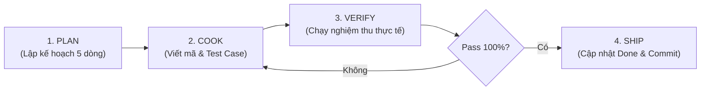

# 🔄 QUY TRÌNH THỰC THI NHIỆM VỤ 4 CHẶNG (WORKFLOW.MD)
## Kế thừa mô hình kỷ luật: Plan → Cook → Verify → Ship (SDLC Discipline)
*Áp dụng bắt buộc cho từng Task trong dự án Lavitree*

---



---

### CHẶNG 1: PLAN (LẬP KẾ HOẠCH BẮT ĐẦU TASK)
* **Thời điểm**: Trước khi chạm vào bất kỳ file mã nguồn nào.
* **Hành động của Developer / Agent**:
  1. Đọc file task tương ứng trong thư mục `tasks/` (ví dụ: `tasks/sprint-01/task-03-database-setup.md`).
  2. Đọc file tài liệu đặc tả liên quan trong `docs/spec/` hoặc `docs/architecture/`.
  3. **Tạo nhánh làm việc riêng cho Task**:
     ```bash
     git checkout main && git pull origin main
     git checkout -b <prefix>/task-<mã-số>-<tên-ngắn-gọn>
     ```
  4. Trình bày ngắn gọn cho User/Team 4 ý:
     - **Mục tiêu task**: Sẽ tạo/sửa file nào?
     - **Input / Output**: Dữ liệu vào là gì, kết quả ra là gì?
     - **Các trường hợp biên (Edge Cases)**: Nếu lỗi mạng, sai định dạng ảnh thì xử lý sao?
     - **Cách thức nghiệm thu**: Sẽ dùng lệnh gì để chứng minh code chạy đúng?

---

### CHẶNG 2: COOK (VIẾT MÃ NGUỒN THEO PHONG CÁCH TDD)
* **Thời điểm**: Sau khi User đồng ý với bản Plan ở Chặng 1.
* **Hành động của Developer / Agent**:
  1. Viết code sạch, phân tách rõ ràng các tầng (Controller / Router $\rightarrow$ Service / Handler $\rightarrow$ Repository / Schema).
  2. Bổ sung docstrings giải thích ngắn gọn mục đích hàm.
  3. **Viết ngay script kiểm thử tương ứng** (ví dụ: `test_predict.py` hoặc file cURL / PowerShell test).
  4. Tuyệt đối không hardcode mật khẩu, token, đường dẫn tuyệt đối máy cá nhân (dùng `.env`).

---

### CHẶNG 3: VERIFY (CHẠY NGHIỆM THU THỰC TẾ - PRESENCE GATES)
* **Thời điểm**: Ngay sau khi viết xong code.
* **Hành động của Developer / Agent**:
  1. Chạy lệnh kiểm thử trực tiếp trong terminal (chạy test suite, gửi request thực tế tới endpoint).
  2. Thu thập bằng chứng thực tế từ stdout terminal:
     - Log trả về thật của server/script (nghiêm cấm tự bịa log hay tự gõ số liệu kết quả đo đạc vào báo cáo).
     - HTTP Response Status (phải là `200 OK` cho ca đúng và `400/422` cho ca nhập sai).
     - Thời gian phản hồi latency đo được thực tế (đáp ứng tiêu chuẩn $< 1.5$ giây của Lavitree).
  3. Nếu xuất hiện bất kỳ lỗi nào $\rightarrow$ Quay lại Chặng 2 để sửa dứt điểm, không được bỏ qua.
  4. Nếu việc đo đạc chuyển sang Sprint sau hoặc chưa có dữ liệu $\rightarrow$ Ghi rõ trạng thái `[Chưa thực hiện / Hoãn sang Sprint X]`, tuyệt đối không sinh số liệu giả lập.

---

### CHẶNG 4: SHIP (ĐÓNG GÓI, CẬP NHẬT TRẠNG THÁI & MERGE)
* **Thời điểm**: Khi mọi bài kiểm thử ở Chặng 3 đã xanh (Pass 100%).
* **Hành động của Developer / Agent**:
  1. Đánh dấu tick `[x]` vào checklist của file `tasks/sprint-xx/task-xx.md`.
  2. Cập nhật trạng thái của task trong `tasks/TODO.md` từ `In Progress` sang `Done`.
  3. Ghi 1 dòng nhật ký vào `tasks/WORKLOG.md` ghi nhận kết quả và bằng chứng test.
  4. Thực hiện git commit theo chuẩn conventional trên nhánh task:
     ```bash
     git commit -m "feat: [TASK-XX] Tên tính năng"
     ```
  5. Đẩy nhánh lên remote và tạo PR hoặc merge an toàn vào `main`:
     ```bash
     git push origin <prefix>/task-<mã-số>-<tên-ngắn-gọn>
     ```
