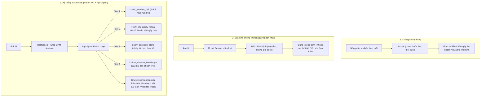

Listed directory LAVITREE
Listed directory LAVITREE
Listed directory .harness
Viewed AGENTS.md:1-52
Viewed workflow.md:1-60
Viewed README.md:1-117
Listed directory docs
Listed directory spec
Listed directory architecture
Listed directory planning
Listed directory doc
Listed directory process
Viewed vision.md:1-48
Searched for "baseline"
Viewed system-design.md:1-150
Viewed system-design.md:150-152
Listed directory app
Listed directory agent
Viewed main.py:1-52
Viewed 2026-10-10.md:1-60
Viewed 2026-10-10.md:60-115
Viewed 2026-10-11.md:1-70
Viewed 2026-10-13.md:1-60
Viewed task-template.md:1-65
Listed directory tasks
Viewed TODO.md:1-70

Dựa trên việc kiểm tra cấu trúc mã nguồn, tài liệu kiến trúc tại [docs/architecture/system-design.md](../../docs/architecture/system-design.md), [docs/spec/vision.md](../../docs/spec/vision.md) và phân hệ [.harness](../../.harness), khái niệm **"Agent"** trong hệ thống **LAVITREE** được áp dụng ở **2 tầng độc lập nhưng bổ trợ cho nhau**:

1. **Tầng Nghiệp vụ Sản phẩm**: Tác tử Khuyến nông Tự hành ([backend/agent-service](../../backend/agent-service) vận hành ReAct Loop + MCP Server).
2. **Tầng Kỹ thuật Phần mềm (SDLC)**: Khung kỷ luật điều phối AI Agent phát triển dự án ([.harness/AGENTS.md](../../.harness/AGENTS.md) và [.harness/workflow.md](../../.harness/workflow.md)).

Dưới đây là so sánh chi tiết lợi ích của việc áp dụng Agent so với **Baseline thông thường** và **Khi không có**:

---

## 1. TẦNG NGHIỆP VỤ SẢN PHẨM: Tác Tử Khuyến Nông (Agri-Agent Service)

Trong kiến trúc của LAVITREE, Agent không chỉ là một chatbot trả lời văn bản, mà là một **ReAct Agent kết nối giao thức MCP (Model Context Protocol)** với 4 công cụ thực tế: `lookup_disease_knowledge`, `check_weather_risk`, `query_pesticide_store`, `verify_phi_safety`.

### Bảng So Sánh Chi Tiết (Tầng Nghiệp Vụ)

| Tiêu chí | Khi KHÔNG CÓ hệ thống | BASELINE thông thường (Chỉ dùng Computer Vision / Chatbot FAQ tĩnh) | LAVITREE có AGENT (ReAct + MCP Tools + Guardrails) |
| :--- | :--- | :--- | :--- |
| **Độ chính xác chẩn đoán** | Dựa vào cảm quan chủ quan, thường phát hiện muộn khi nấm đã lan rộng, thất thoát **30–70%** sản lượng. | Phân loại dán nhãn bệnh học (chỉ ra nhãn lớp bệnh). Dễ chẩn đoán sai khi ảnh chụp ngoài trời (Domain Shift). | Kết hợp **ResNet-18 + Grad-CAM** soi vùng nấm + lọc bất định ($<70\%$ yêu cầu chụp lại) + Agent đối chiếu triệu chứng. |
| **Tính giải thích & Minh bạch** | Không có cơ sở khoa học. | **Hộp đen (Black-box)**: Không biết tại sao mô hình lại đoán là bệnh đó; chatbot sinh văn bản có nguy cơ **bịa đặt (Hallucination)**. | **Explainable AI (XAI)**: Grad-CAM chỉ rõ vị trí vết bệnh trên lá; Agent có **Waterfall Trace Log** minh bạch từng bước suy luận (`Thought → Action → Observation`) với dẫn xuất từ **112 bài báo khoa học đối chứng**. |
| **Khả năng phản ứng đa biến số** | Không tính toán được (nông dân thường phun xong gặp mưa trôi hết thuốc). | **Tĩnh & Một chiều**: Chỉ hiển thị văn bản cứng gắn sẵn trong DB theo mã bệnh, không biết hôm nay trời mưa hay nắng, cây sắp thu hoạch hay chưa. | **Động & Đa biến**: Tự động gọi tool kiểm tra thời tiết (nếu sắp mưa $\rightarrow$ hoãn phun), kiểm tra số ngày trước thu hoạch (nếu $\le 3$ ngày $\rightarrow$ chặn thuốc hóa học, chuyển sang chế phẩm sinh học). |
| **An toàn vệ sinh & Dư lượng thuốc (PHI)** | Thường xuyên vi phạm thời gian cách ly thuốc BVTV do muốn thu hoạch sớm hoặc thiếu kiến thức. | Không có cơ chế can thiệp hay cảnh báo an toàn thực phẩm theo thời gian thực. | **Boundary Guardrails**: Tự động chặn đơn thuốc nếu vi phạm chỉ số PHI (*Pre-Harvest Interval*), kích hoạt cơ chế chuyển giao chuyên gia/bác sĩ cây trồng (**Human-in-the-loop**). |
| **Chu trình khép kín (End-to-End)** | Phải tự tìm đại lý, dễ mua phải hàng giả, hàng kém chất lượng. | Dừng lại ở màn hình kết quả thông tin; người dùng không biết mua ở đâu, lượng pha bình 16L ra sao. | Tích hợp **Lavitree Store**: Tự động kiểm tra tồn kho thuốc đặc trị tại kho gần nhất (Hà Nội, Lâm Đồng, Cần Thơ) và hỗ trợ đặt hàng trực tiếp. |

---

## 2. TẦNG QUY TRÌNH PHÁT TRIỂN: Khung Kỷ Luật Agent SDLC ([.harness](../../.harness))

Thư mục [.harness](../../.harness) đóng vai trò là **"Hệ quy tắc & Môi trường nghiệm thu" (Harness)** để lập trình viên con người làm việc phối hợp với AI Coding Agent một cách an toàn, tránh tình trạng AI tự do sinh mã hỏng.

| Tiêu chí | Khi KHÔNG DÙNG AI (Lập trình thủ công 100%) | BASELINE AI thông thường (Dùng Copilot/ChatGPT tự do không có Harness) | Áp dụng KHUNG HARNESS ([.harness](../../.harness)) |
| :--- | :--- | :--- | :--- |
| **Tốc độ & Năng suất** | 2 thành viên khó có thể hoàn thành Monorepo gồm 5 phân hệ công nghệ lớn (.NET 8, FastAPI PyTorch, Android Jetpack Compose, React Vite, PostgreSQL, AWS EC2) trong 10 tuần. | Viết code nhanh ban đầu, nhưng phát sinh nhiều mã rác, code chắp vá, mất nhiều thời gian fix bug tích hợp về sau. | Tăng tốc độ viết mã vượt trội nhờ chia nhỏ theo [task-template.md](../../.harness/task-template.md), 1 Task = 1 luồng công việc dứt điểm. |
| **Hiện tượng Ảo giác (Hallucination / Mocking)** | Không xảy ra (do người tự viết). | **Rất phổ biến**: AI tự ý tạo hàm giả lập (mocking), fake kết quả chẩn đoán, tự ý xóa sửa cấu trúc file có sẵn khi không tìm thấy file. | **Triệt tiêu hoàn toàn**: Quy định cấm trong [AGENTS.md](../../.harness/AGENTS.md) (CẤM mock core AI, bắt buộc nạp model `best_plant_model.pt` thật và tính Grad-CAM thật). |
| **Quản lý Ngữ cảnh (Context Window)** | Nằm hoàn toàn trong đầu lập trình viên. | AI đọc tràn lan toàn bộ repo hoặc quên quy tắc dự án, dẫn đến phản hồi lạc đề hoặc vượt ngưỡng token. | **Context Isolation**: Ràng buộc AI chỉ được đọc tài liệu liên quan trực tiếp trong `docs/`, giữ bộ nhớ cho tư duy logic thuật toán. |
| **Chất lượng bàn giao & Kiểm thử** | Dễ bỏ qua viết unit test khi bị áp lực tiến độ (deadline). | AI sinh code xong tự nhận là "xong" dù chưa bao giờ chạy thử trên môi trường thực tế. | **Kỷ luật Presence Gates & Quy trình 4 chặng ([workflow.md](../../.harness/workflow.md))**: Phải qua đủ 4 bước *Plan $\rightarrow$ Cook $\rightarrow$ Verify $\rightarrow$ Ship*. Chỉ được coi là `Done` khi có log thực thi lệnh terminal chứng minh `Pass 100%`. |
| **Tính toàn vẹn hệ thống** | Đòi hỏi trao đổi thủ công giữa các thành viên để không xung đột DB schema. | AI tự tiện đổi schema DB trong code nhưng không cập nhật tài liệu kiến trúc, làm vỡ hệ thống phía frontend/mobile. | Bắt buộc đồng bộ hóa 2 chiều: Mọi thay đổi schema DB phải cập nhật ngược lại [database-schema.md](../../docs/architecture/database-schema.md) trước khi merge. |

---

## 3. TỔNG KẾT GIÁ TRỊ CỐT LÕI

- **Đối với người dùng cuối (Nông dân & Bác sĩ cây trồng)**: Việc áp dụng Agent biến LAVITREE từ một **"công cụ dán nhãn ảnh tĩnh"** trở thành một **"trợ lý tư vấn có khả năng hành động, có trách nhiệm và giải thích được"**, đảm bảo tuyệt đối an toàn vệ sinh mùa vụ và chống lạm dụng hóa chất.
- **Đối với nhóm phát triển dự án**: Khung harness ([.harness](../../.harness)) đóng vai trò như một **bộ khung kỷ luật kỹ thuật (Engineering Safeguard)**, cho phép tận dụng tối đa năng lực tự động hóa của AI mà không làm suy giảm chất lượng kiến trúc mã nguồn.