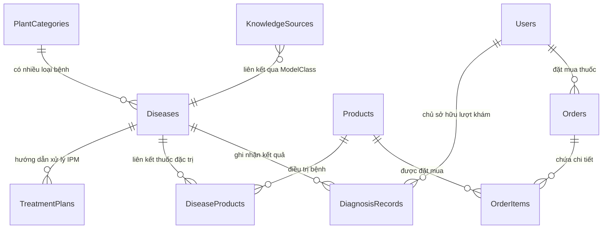

# 🗄️ THIẾT KẾ CƠ SỞ DỮ LIỆU POSTGRESQL (DATABASE-SCHEMA.MD)
## Hệ thống Lavitree — Chuẩn hóa 10 Bảng dữ liệu quan hệ (3NF)
*Khớp 100% với LavitreeDbContext và Entity Framework Core Migrations trong `backend/core-api`*

---

## 1. SƠ ĐỒ THỰC THỂ QUAN HỆ (ERD - ENTITY RELATIONSHIP DIAGRAM)

---

## 2. CHI TIẾT 10 BẢNG DỮ LIỆU CHUẨN HÓA

### Nhóm 1: Tri thức Bệnh & Cây trồng (Core Domain Knowledge)

#### 1. `PlantCategories` (Loài cây trồng)
Lưu 14 loài cây mục tiêu của Lavitree (Cà chua, Khoai tây, Ngô, Táo, Nho, Ớt chuông, Cam...).
| Cột (Column) | Kiểu dữ liệu | Ràng buộc | Mô tả |
|---|---|---|---|
| `Id` | `SERIAL` | PK | Mã định danh loài cây |
| `NameVi` | `VARCHAR(100)` | UNIQUE, NOT NULL | Tên tiếng Việt (Ví dụ: "Cà chua", "Khoai tây") |
| `ScientificName` | `VARCHAR(150)` | NULL | Tên khoa học |
| `IconUrl` | `VARCHAR(255)` | NULL | Biểu tượng minh họa |

#### 2. `Diseases` (Danh mục 40 lớp: 38 lớp AI Vision + 2 lớp Cẩm nang Canh tác Cây khỏe)
*Lưu ý kiến trúc: Gồm 38 lớp có AI nhận diện tự động + 2 lớp cẩm nang canh tác (`Orange___healthy` & `Squash___healthy`) để đảm bảo toàn bộ 14 loài cây trồng đều có tài liệu hướng dẫn chăm sóc và khớp 100% với 112 bài báo trong KnowledgeSources.*
| Cột (Column) | Kiểu dữ liệu | Ràng buộc | Mô tả |
|---|---|---|---|
| `Id` | `SERIAL` | PK | Mã định danh bệnh |
| `PlantId` | `INT` | FK $\rightarrow$ PlantCategories | Thuộc loài cây nào |
| `ClassCode` | `VARCHAR(100)` | UNIQUE, NOT NULL | Mã nhãn Model (Ví dụ: `Tomato___Late_blight`) |
| `CommonNameVi` | `VARCHAR(150)` | NOT NULL | Tên bệnh tiếng Việt ("Bệnh mốc sương cà chua") |
| `PathogenType` | `VARCHAR(50)` | NOT NULL | Tác nhân: Nấm / Vi khuẩn / Virus / Khỏe mạnh |
| `Symptoms` | `TEXT` | NOT NULL | Triệu chứng nhận diện bề mặt lá |
| `Prevention` | `TEXT` | NOT NULL | Biện pháp canh tác phòng ngừa |
| `SeverityLevel` | `INT` | DEFAULT 2 | Mức độ nghiêm trọng (1: Nhẹ, 2: Vừa, 3: Nguy hiểm) |

#### 3. `TreatmentPlans` (Hướng dẫn xử lý theo từng tình trạng bệnh & cây trồng chuẩn Khuyến Nông IPM)
*Cấu trúc linh hoạt 1-nhiều: mỗi lớp bệnh/cây khỏe có các bước xử lý tương ứng (Canh tác & cơ học $\rightarrow$ Hóa sinh / Sinh học có kiểm soát $\rightarrow$ Phục hồi dinh dưỡng).*
| Cột (Column) | Kiểu dữ liệu | Ràng buộc | Mô tả |
|---|---|---|---|
| `Id` | `SERIAL` | PK | Mã hướng dẫn |
| `DiseaseId` | `INT` | FK $\rightarrow$ Diseases | Áp dụng cho bệnh / tình trạng nào |
| `StepOrder` | `INT` | NOT NULL | Thứ tự thực hiện (1: Canh tác/Cắt tỉa, 2: Hóa sinh/Sinh học nếu có, 3: Phục hồi) |
| `ActionTitle` | `VARCHAR(150)` | NOT NULL | Tiêu đề hành động (Ví dụ: "Phun thuốc phòng trừ nấm mốc sương", hoặc "Quy trình tưới tiêu định kỳ") |
| `Instructions` | `TEXT` | NOT NULL | Hướng dẫn chi tiết kỹ thuật canh tác hoặc pha bình 16L tham khảo |
| `IsolationDays` | `VARCHAR(50)` | NULL | Thời gian cách ly an toàn (PHI: "7-14 ngày", để trống nếu là biện pháp sinh học/canh tác) |

#### 4. `KnowledgeSources` (Kho bài báo đối chứng & Kỹ thuật canh tác)
*Khớp 100% với dữ liệu thu thập được từ `KnowledgeSources_rows.csv` (112 bản ghi). Từ Sprint 2 & Sprint 3 (TASK-15), một bài báo có thể sinh **nhiều dòng** (mỗi đoạn nguyên văn được duyệt = 1 dòng, tối đa 8 đoạn / `SourceUrl` và $\le \max(1200, 30\%)$ độ dài bài viết), nên **không** đặt Unique trên `(ModelClass, SourceUrl)`. Chống trùng do Core API kiểm tra: không lưu hai đoạn trùng chữ của cùng `SourceUrl`; seeder kiểm tra theo `Id` khi nạp lại CSV.*
| Cột (Column) | Kiểu dữ liệu | Ràng buộc | Mô tả |
|---|---|---|---|
| `Id` | `UUID` | PK | Mã nguồn tri thức |
| `ModelClass` | `VARCHAR(100)` | INDEX, NOT NULL | Khớp với `Diseases.ClassCode` |
| `PlantName` | `VARCHAR(100)` | NOT NULL | Tên cây tiếng Việt |
| `DiseaseName` | `VARCHAR(150)` | NOT NULL | Tên bệnh tiếng Việt |
| `SourceUrl` | `VARCHAR(500)` | NOT NULL | Link bài báo Khuyến Nông / Đại học |
| `SourceTitle` | `VARCHAR(300)` | NOT NULL | Tiêu đề bài viết |
| `Organization` | `VARCHAR(200)` | NOT NULL | Viện nghiên cứu / Trường Đại học / Tổ chức phát hành |
| `PublishedDate`| `VARCHAR(50)`  | NULL | Ngày xuất bản |
| `SourceScope`  | `VARCHAR(50)`  | DEFAULT 'Việt Nam' | Phạm vi tài liệu ('Việt Nam' \| 'Quốc tế') |
| `EvidenceText` | `TEXT`         | NOT NULL | Nội dung dùng cho RAG: đoạn **nguyên văn** (nếu `IsVerbatim = true`, ≤ 800 ký tự) hoặc **tóm tắt** (dữ liệu cũ) |
| `UnitType`     | `VARCHAR(30)`  | NOT NULL, DEFAULT 'SUMMARY' | `SYMPTOMS` \| `CAUSE_CONDITIONS` \| `PREVENTION` \| `TREATMENT` \| `SUMMARY` (112 bài cũ = `SUMMARY`) |
| `IsVerbatim`   | `BOOLEAN`      | NOT NULL, DEFAULT FALSE | `true` = chép nguyên văn từ bài gốc (không được sửa chữ); `false` = tóm tắt |
| `ContentType`  | `VARCHAR(100)` | NOT NULL | Triệu chứng & Biện pháp \| Kỹ thuật canh tác |
| `MatchLevel`   | `VARCHAR(50)`  | DEFAULT 'Khớp trực tiếp' | Mức độ khớp nội dung |
| `HasCultivationTechnique` | `BOOLEAN` | DEFAULT FALSE | Có hướng dẫn chăm sóc phòng ngừa |
| `SourceQuality`| `VARCHAR(50)`  | DEFAULT 'Cao' | Cao \| Trung bình \| Duyệt ngoại lệ |
| `IsManualApproved` | `BOOLEAN` | DEFAULT FALSE | Đã kiểm duyệt thủ công |
| `ReviewerNotes`| `TEXT`         | NULL | Ghi chú người duyệt |

#### 4b. `KnowledgeImages` (Kho ảnh triệu chứng thực địa theo bộ phận cây — Task-15 Phase 2)
*Lưu trữ ảnh thực tế của bệnh theo bộ phận (lá, quả, thân, toàn cây), hiển thị trong Sổ tay bệnh học `/handbook/:classCode` và phục vụ nông dân đối chiếu thực địa.*
| Cột (Column) | Kiểu dữ liệu | Ràng buộc | Mô tả |
|---|---|---|---|
| `Id` | `SERIAL` | PK | Mã định danh ảnh triệu chứng |
| `ModelClass` | `VARCHAR(100)` | INDEX, NOT NULL | Mã nhãn bệnh (khớp với `Diseases.ClassCode`) |
| `SourceUrl` | `VARCHAR(500)` | NOT NULL | Link bài viết gốc có chứa ảnh triệu chứng |
| `ImageUrl` | `VARCHAR(500)` | NULL | Đường dẫn HTTPS ảnh ngoài (nếu không tải lên MinIO) |
| `StorageKey` | `VARCHAR(255)` | NULL | Khóa tệp trên MinIO bucket `lavitree-images` (đã xóa EXIF) |
| `Caption` | `VARCHAR(300)` | NOT NULL | Chú thích / mô tả triệu chứng lâm sàng thể hiện trong ảnh |
| `PlantPart` | `VARCHAR(20)` | NOT NULL, DEFAULT 'LEAF' | Bộ phận cây: `LEAF` \| `FRUIT` \| `STEM` \| `WHOLE_PLANT` |
| `Credit` | `VARCHAR(200)` | NOT NULL | Tác giả / cơ quan sở hữu bản quyền ảnh |
| `LicenseNote` | `VARCHAR(200)` | NULL | Ghi chú giấy phép sử dụng (trích dẫn học thuật, CC-BY...) |
| `IsManualApproved` | `BOOLEAN` | NOT NULL, DEFAULT TRUE | Trạng thái duyệt của Admin (chỉ ảnh đã duyệt mới hiện lên Sổ tay) |
| `IsDeleted` | `BOOLEAN` | NOT NULL, DEFAULT FALSE | Đánh dấu xóa mềm |
| `CreatedAt` | `TIMESTAMPTZ` | NOT NULL, DEFAULT NOW() | Thời gian tạo |
| `UpdatedAt` | `TIMESTAMPTZ` | NULL | Thời gian cập nhật |

---

### Nhóm 2: Lịch sử Khám bệnh & Chẩn đoán AI

#### 5. `DiagnosisRecords` (Lịch sử chẩn đoán của Nông Dân)
| Cột (Column) | Kiểu dữ liệu | Ràng buộc | Mô tả |
|---|---|---|---|
| `Id` | `UUID` | PK | Mã lượt chẩn đoán |
| `UserId` | `UUID` | FK $\rightarrow$ Users, NULL | Người dùng thực hiện (hỗ trợ khách vãng lai) |
| `DiseaseId` | `INT` | FK $\rightarrow$ Diseases | Kết quả bệnh dự đoán cao nhất |
| `OriginalImageUrl` | `VARCHAR(500)` | NOT NULL | Đường dẫn ảnh lá gốc người dùng tải lên |
| `GradCamImageUrl` | `VARCHAR(500)` | NULL | Đường dẫn ảnh nhiệt Grad-CAM do AI sinh |
| `Confidence` | `FLOAT` | NOT NULL | Điểm tin cậy (Ví dụ: 0.946 = 94.6%) |
| `IsUncertain` | `BOOLEAN` | DEFAULT FALSE | Cờ cảnh báo bất định (confidence $< 0.70$) |
| `Notes` | `TEXT` | NULL | Ghi chú của nông dân lúc khám; khi nhờ Bác sĩ, mô tả mới được nối thêm sau dòng `[Gửi Bác sĩ]:` (tối đa 4000 ký tự) |
| `RecoveryStatus` | `VARCHAR(50)` | DEFAULT 'Đang theo dõi' | 'Đang theo dõi' \| 'Đã phục hồi' \| 'Tái phát' |
| `Top3Json` | `TEXT` | NULL | Dự đoán Top-3 của mô hình Vision dưới dạng JSON (class_name, confidence) |
| `ConfusionGroup` | `TEXT` | NULL | Nhóm bệnh dễ nhầm do AI Service trả về lúc khám (vd: `TOMATO_LEAF_SPOT`) |
| `RequiresExpert` | `BOOLEAN` | DEFAULT FALSE | Cờ chuyển ca khó cho Bác sĩ Cây trồng thẩm định (HITL) |
| `ExpertNotes` | `TEXT` | NULL | Kết luận chuyên môn của Bác sĩ Cây trồng (API giới hạn 2000 ký tự, tách biệt với `Notes` của nông dân) |
| `ExpertReviewedAt` | `TIMESTAMPTZ` | NULL | Thời điểm Bác sĩ Cây trồng hoàn tất thẩm định ca bệnh |
| `CreatedAt` | `TIMESTAMPTZ` | DEFAULT NOW() | Thời điểm chẩn đoán |

---

### Nhóm 3: Tiệm thuốc Bảo Vệ Thực Vật & Đơn Hàng (E-Commerce)

#### 6. `Products` (Danh mục thuốc đặc trị & chế phẩm sinh học & vật tư canh tác - SSOT)
| Cột (Column) | Kiểu dữ liệu | Ràng buộc | Mô tả |
|---|---|---|---|
| `Id` | `SERIAL` | PK | Mã sản phẩm |
| `Name` | `VARCHAR(150)` | NOT NULL | Tên thương mại (Ridomil Gold, Antracol, Trichoderma, Bẫy dính...) |
| `ActiveIngredient` | `VARCHAR(150)` | NULL | Hoạt chất chính (Mancozeb, Metalaxyl-M, Propineb... null đối với vật tư canh tác) |
| `Price` | `DECIMAL(12,2)` | NOT NULL | Đơn giá niêm yết (VNĐ) |
| `DosageInstruction`| `TEXT` | NOT NULL | Hướng dẫn liều lượng pha phun hoặc cách lắp đặt |
| `ImageUrl` | `VARCHAR(500)` | NULL | Hình ảnh bao bì sản phẩm |
| `StockQuantity` | `INT` | DEFAULT 100 | Số lượng tồn kho |
| `PhiDays` | `INT` | NULL | Thời gian cách ly an toàn (PHI tính theo ngày; null đối với vật tư canh tác) |
| `IsAllowed` | `BOOLEAN` | DEFAULT TRUE | Trạng thái cho phép lưu hành tại VN (Cục BVTV / TT 75/2025) |
| `RainResistant` | `BOOLEAN` | DEFAULT FALSE | Khả năng chống chịu mưa rửa trôi của thuốc |
| `MedicineType` | `VARCHAR(50)` | DEFAULT 'Hóa học' | 'Hóa học' \| 'Sinh học' \| 'Vật tư canh tác' |
| `Availability` | `VARCHAR(20)` | NOT NULL, DEFAULT 'IN_STOCK', CHECK | 'IN_STOCK' \| 'OUT_OF_STOCK' \| 'NOT_SOLD' (Cửa hàng không bán - chỉ tư vấn kỹ thuật) |
| `InfoSourceUrl` | `VARCHAR(500)` | NULL | Nơi Admin tra PHI/liều (nhãn, trang nhà sản xuất). Bắt buộc với thuốc (kiểm tra ở Core API) |

*Ràng buộc CHECK (migration `20261111080000_AddProductSuggestionsAndRefineProducts`): `CK_Products_PhiDays_RequiredForMedicine` (`PhiDays IS NOT NULL OR MedicineType = 'Vật tư canh tác'`) và `CK_Products_Availability`.*

#### 7. `DiseaseProducts` (Bảng trung gian: Bệnh $\leftrightarrow$ Thuốc đặc trị)
| Cột (Column) | Kiểu dữ liệu | Ràng buộc | Mô tả |
|---|---|---|---|
| `DiseaseId` | `INT` | PK, FK $\rightarrow$ Diseases | Mã bệnh |
| `ProductId` | `INT` | PK, FK $\rightarrow$ Products | Mã thuốc đặc trị tương ứng |

#### 8. `Users` (Người dùng: Nông dân & Quản trị viên)
| Cột (Column) | Kiểu dữ liệu | Ràng buộc | Mô tả |
|---|---|---|---|
| `Id` | `UUID` | PK | Mã tài khoản |
| `FullName` | `VARCHAR(100)` | NOT NULL | Họ và tên |
| `Email` | `VARCHAR(150)` | UNIQUE, NOT NULL | Email đăng nhập |
| `PasswordHash` | `VARCHAR(255)` | NOT NULL | Mật khẩu mã hóa BCrypt |
| `Role` | `VARCHAR(50)` | DEFAULT 'FARMER' | 'FARMER' \| 'ADMIN' |
| `Phone` | `VARCHAR(20)` | NULL | Số điện thoại |

#### 9. `Orders` (Đơn hàng mua thuốc bảo vệ thực vật)
| Cột (Column) | Kiểu dữ liệu | Ràng buộc | Mô tả |
|---|---|---|---|
| `Id` | `UUID` | PK | Mã đơn hàng |
| `UserId` | `UUID` | FK $\rightarrow$ Users | Người đặt |
| `ReceiverName` | `TEXT` | NULL | Họ tên người nhận hàng tại vườn (API giới hạn 100 ký tự) |
| `Notes` | `TEXT` | NULL | Ghi chú giao hàng của nông dân |
| `TotalAmount` | `DECIMAL(12,2)` | NOT NULL | Tổng tiền thanh toán (tính chuẩn từ CSDL) |
| `PaymentMethod` | `VARCHAR(50)` | DEFAULT 'COD' | 'COD' \| 'VietQR' |
| `OrderStatus` | `VARCHAR(50)` | DEFAULT 'Pending' | 'Pending' \| 'Paid' \| 'Delivered' |
| `ShippingAddress` | `VARCHAR(255)` | NOT NULL | Địa chỉ nhận hàng tại vườn |
| `PhoneNumber` | `TEXT` | NOT NULL | Số di động liên hệ giao hàng (API kiểm tra định dạng `0[35789]` + 8 số) |

#### 10. `OrderItems` (Chi tiết từng món thuốc trong đơn)
| Cột (Column) | Kiểu dữ liệu | Ràng buộc | Mô tả |
|---|---|---|---|
| `Id` | `SERIAL` | PK | Mã chi tiết |
| `OrderId` | `UUID` | FK $\rightarrow$ Orders | Thuộc đơn hàng nào |
| `ProductId` | `INT` | FK $\rightarrow$ Products | Mua loại thuốc nào |
| `Quantity` | `INT` | NOT NULL | Số lượng mua |
| `UnitPrice` | `DECIMAL(12,2)` | NOT NULL | Đơn giá tại thời điểm đặt |

#### 11. `ProductSuggestions` (Gợi ý vật tư trích xuất từ bài báo tri thức — Task-15 Phase 3)
| Cột (Column) | Kiểu dữ liệu | Ràng buộc | Mô tả |
|---|---|---|---|
| `Id` | `SERIAL` | PK | Khóa chính tự tăng |
| `KnowledgeSourceId` | `UUID` | FK $\rightarrow$ KnowledgeSources | Mã đoạn văn bản nguồn chứa cụm từ gợi ý |
| `ModelClass` | `VARCHAR(100)` | INDEX, NOT NULL | Mã định danh lớp bệnh liên quan |
| `MentionText` | `VARCHAR(200)` | NOT NULL | Cụm từ vật tư, hoạt chất hoặc biện pháp xuất hiện nguyên văn |
| `Kind` | `VARCHAR(50)` | NOT NULL | Phân loại: 'CHEMICAL' \| 'BIOLOGICAL' \| 'SUPPLY' \| 'PRACTICE' |
| `Status` | `VARCHAR(50)` | DEFAULT 'PENDING' | Trạng thái xử lý: 'PENDING' \| 'LINKED' \| 'ADDED' \| 'DISMISSED' |
| `ProductId` | `INT` | NULL, FK $\rightarrow$ Products | Sản phẩm đã liên kết trong kho (nếu có) |
| `CreatedAt` | `TIMESTAMPTZ` | DEFAULT NOW() | Thời điểm tạo gợi ý |
| `ResolvedAt` | `TIMESTAMPTZ` | NULL | Thời điểm Admin xử lý giải quyết |

---

## 3. CHIẾN LƯỢC SEED DATA (NẠP DỮ LIỆU BAN ĐẦU)

Khi khởi động hệ thống lần đầu:
1. Nạp 14 loài cây vào bảng `PlantCategories`.
2. Nạp 38 lớp cây trồng & bệnh vào bảng `Diseases` (theo đúng `class_indices.json`).
3. Nạp 112 bài báo đã xác minh từ `KnowledgeSources_rows.csv` vào bảng `KnowledgeSources`.
4. Nạp danh mục thuốc đặc trị mẫu vào bảng `Products` và liên kết với `DiseaseProducts`.
