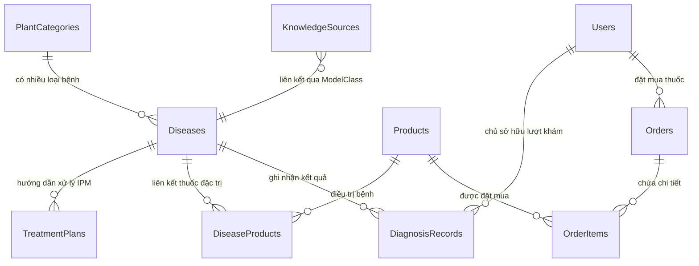

# 🗄️ THIẾT KẾ CƠ SỞ DỮ LIỆU POSTGRESQL (DATABASE-SCHEMA.MD)
## Hệ thống Lavitree — Chuẩn hóa 10 Bảng dữ liệu quan hệ (3NF)
*Khớp 100% với LavitreeDbContext và Entity Framework Core Migrations trong `backend/core-api`*

---

## 1. SƠ ĐỒ THỰC THỂ QUAN HỆ (ERD - ENTITY RELATIONSHIP DIAGRAM)

---

## 2. CHI TIẾT 10 BẢNG DỮ LIỆU CHUẨN HÓA

### Nhóm 1: Tri thức Bệnh & Cây trồng (Core Domain Knowledge)

#### 1. `PlantCategories` (Loài cây trồng)
Lưu 14 loài cây mục tiêu của Lavitree (Cà chua, Khoai tây, Ngô, Táo, Nho, Ớt chuông, Cam...).
| Cột (Column) | Kiểu dữ liệu | Ràng buộc | Mô tả |
|---|---|---|---|
| `Id` | `SERIAL` | PK | Mã định danh loài cây |
| `NameVi` | `VARCHAR(100)` | UNIQUE, NOT NULL | Tên tiếng Việt (Ví dụ: "Cà chua", "Khoai tây") |
| `ScientificName` | `VARCHAR(150)` | NULL | Tên khoa học |
| `IconUrl` | `VARCHAR(255)` | NULL | Biểu tượng minh họa |

#### 2. `Diseases` (Danh mục 40 lớp: 38 lớp AI Vision + 2 lớp Cẩm nang Canh tác Cây khỏe)
*Lưu ý kiến trúc: Gồm 38 lớp có AI nhận diện tự động + 2 lớp cẩm nang canh tác (`Orange___healthy` & `Squash___healthy`) để đảm bảo toàn bộ 14 loài cây trồng đều có tài liệu hướng dẫn chăm sóc và khớp 100% với 112 bài báo trong KnowledgeSources.*
| Cột (Column) | Kiểu dữ liệu | Ràng buộc | Mô tả |
|---|---|---|---|
| `Id` | `SERIAL` | PK | Mã định danh bệnh |
| `PlantId` | `INT` | FK $\rightarrow$ PlantCategories | Thuộc loài cây nào |
| `ClassCode` | `VARCHAR(100)` | UNIQUE, NOT NULL | Mã nhãn Model (Ví dụ: `Tomato___Late_blight`) |
| `CommonNameVi` | `VARCHAR(150)` | NOT NULL | Tên bệnh tiếng Việt ("Bệnh mốc sương cà chua") |
| `PathogenType` | `VARCHAR(50)` | NOT NULL | Tác nhân: Nấm / Vi khuẩn / Virus / Khỏe mạnh |
| `Symptoms` | `TEXT` | NOT NULL | Triệu chứng nhận diện bề mặt lá |
| `Prevention` | `TEXT` | NOT NULL | Biện pháp canh tác phòng ngừa |
| `SeverityLevel` | `INT` | DEFAULT 2 | Mức độ nghiêm trọng (1: Nhẹ, 2: Vừa, 3: Nguy hiểm) |

#### 3. `TreatmentPlans` (Hướng dẫn xử lý theo từng tình trạng bệnh & cây trồng chuẩn Khuyến Nông IPM)
*Cấu trúc linh hoạt 1-nhiều: mỗi lớp bệnh/cây khỏe có các bước xử lý tương ứng (Canh tác & cơ học $\rightarrow$ Hóa sinh / Sinh học có kiểm soát $\rightarrow$ Phục hồi dinh dưỡng).*
| Cột (Column) | Kiểu dữ liệu | Ràng buộc | Mô tả |
|---|---|---|---|
| `Id` | `SERIAL` | PK | Mã hướng dẫn |
| `DiseaseId` | `INT` | FK $\rightarrow$ Diseases | Áp dụng cho bệnh / tình trạng nào |
| `StepOrder` | `INT` | NOT NULL | Thứ tự thực hiện (1: Canh tác/Cắt tỉa, 2: Hóa sinh/Sinh học nếu có, 3: Phục hồi) |
| `ActionTitle` | `VARCHAR(150)` | NOT NULL | Tiêu đề hành động (Ví dụ: "Phun thuốc phòng trừ nấm mốc sương", hoặc "Quy trình tưới tiêu định kỳ") |
| `Instructions` | `TEXT` | NOT NULL | Hướng dẫn chi tiết kỹ thuật canh tác hoặc pha bình 16L tham khảo |
| `IsolationDays` | `VARCHAR(50)` | NULL | Thời gian cách ly an toàn (PHI: "7-14 ngày", để trống nếu là biện pháp sinh học/canh tác) |

#### 4. `KnowledgeSources` (Kho bài báo đối chứng & Kỹ thuật canh tác)
*Khớp 100% với dữ liệu thu thập được từ `KnowledgeSources_rows.csv` (112 bản ghi). Ràng buộc Unique trên cặp `(ModelClass, SourceUrl)` để ngăn chặn triệt để nguy cơ nhân đôi dữ liệu khi nạp lại.*
| Cột (Column) | Kiểu dữ liệu | Ràng buộc | Mô tả |
|---|---|---|---|
| `Id` | `UUID` | PK | Mã nguồn tri thức |
| `ModelClass` | `VARCHAR(100)` | INDEX, NOT NULL | Khớp với `Diseases.ClassCode` |
| `PlantName` | `VARCHAR(100)` | NOT NULL | Tên cây tiếng Việt |
| `DiseaseName` | `VARCHAR(150)` | NOT NULL | Tên bệnh tiếng Việt |
| `SourceUrl` | `VARCHAR(500)` | NOT NULL | Link bài báo Khuyến Nông / Đại học |
| `SourceTitle` | `VARCHAR(300)` | NOT NULL | Tiêu đề bài viết |
| `Organization` | `VARCHAR(200)` | NOT NULL | Viện nghiên cứu / Trường Đại học / Tổ chức phát hành |
| `PublishedDate`| `VARCHAR(50)`  | NULL | Ngày xuất bản |
| `SourceScope`  | `VARCHAR(50)`  | DEFAULT 'Việt Nam' | Phạm vi tài liệu ('Việt Nam' \| 'Quốc tế') |
| `EvidenceText` | `TEXT`         | NOT NULL | Đoạn trích dẫn bằng chứng triệu chứng & phòng trị |
| `ContentType`  | `VARCHAR(100)` | NOT NULL | Triệu chứng & Biện pháp \| Kỹ thuật canh tác |
| `MatchLevel`   | `VARCHAR(50)`  | DEFAULT 'Khớp trực tiếp' | Mức độ khớp nội dung |
| `HasCultivationTechnique` | `BOOLEAN` | DEFAULT FALSE | Có hướng dẫn chăm sóc phòng ngừa |
| `SourceQuality`| `VARCHAR(50)`  | DEFAULT 'Cao' | Cao \| Trung bình \| Duyệt ngoại lệ |
| `IsManualApproved` | `BOOLEAN` | DEFAULT FALSE | Đã kiểm duyệt thủ công |
| `ReviewerNotes`| `TEXT`         | NULL | Ghi chú người duyệt |

---

### Nhóm 2: Lịch sử Khám bệnh & Chẩn đoán AI

#### 5. `DiagnosisRecords` (Lịch sử chẩn đoán của Nông Dân)
| Cột (Column) | Kiểu dữ liệu | Ràng buộc | Mô tả |
|---|---|---|---|
| `Id` | `UUID` | PK | Mã lượt chẩn đoán |
| `UserId` | `UUID` | FK $\rightarrow$ Users, NULL | Người dùng thực hiện (hỗ trợ khách vãng lai) |
| `DiseaseId` | `INT` | FK $\rightarrow$ Diseases | Kết quả bệnh dự đoán cao nhất |
| `OriginalImageUrl` | `VARCHAR(500)` | NOT NULL | Đường dẫn ảnh lá gốc người dùng tải lên |
| `GradCamImageUrl` | `VARCHAR(500)` | NULL | Đường dẫn ảnh nhiệt Grad-CAM do AI sinh |
| `Confidence` | `FLOAT` | NOT NULL | Điểm tin cậy (Ví dụ: 0.946 = 94.6%) |
| `IsUncertain` | `BOOLEAN` | DEFAULT FALSE | Cờ cảnh báo bất định (confidence $< 0.70$) |
| `Notes` | `TEXT` | NULL | Ghi chú của nông dân khi theo dõi |
| `RecoveryStatus` | `VARCHAR(50)` | DEFAULT 'Đang theo dõi' | 'Đang theo dõi' \| 'Đã phục hồi' \| 'Tái phát' |
| `CreatedAt` | `TIMESTAMPTZ` | DEFAULT NOW() | Thời điểm chẩn đoán |

---

### Nhóm 3: Tiệm thuốc Bảo Vệ Thực Vật & Đơn Hàng (E-Commerce)

#### 6. `Products` (Danh mục thuốc đặc trị & chế phẩm sinh học)
| Cột (Column) | Kiểu dữ liệu | Ràng buộc | Mô tả |
|---|---|---|---|
| `Id` | `SERIAL` | PK | Mã sản phẩm |
| `Name` | `VARCHAR(150)` | NOT NULL | Tên thương mại (Ridomil Gold, Aliette, Trichoderma...) |
| `ActiveIngredient` | `VARCHAR(150)` | NOT NULL | Hoạt chất chính (Mancozeb, Metalaxyl...) |
| `Price` | `DECIMAL(12,2)` | NOT NULL | Đơn giá niêm yết (VNĐ) |
| `Unit` | `VARCHAR(50)` | DEFAULT 'Gói 100g' | Quy cách đóng gói (Gói / Chai / Can) |
| `ImageUrl` | `VARCHAR(500)` | NULL | Hình ảnh bao bì sản phẩm |
| `StockQuantity` | `INT` | DEFAULT 100 | Số lượng tồn kho |
| `IsAllowed` | `BOOLEAN` | DEFAULT TRUE | Thuốc được phép lưu hành tại VN (Cục BVTV) |
| `IsolationDays` | `INT` | DEFAULT 7 | Thời gian cách ly an toàn (PHI tính theo ngày) |

#### 7. `DiseaseProducts` (Bảng trung gian: Bệnh $\leftrightarrow$ Thuốc đặc trị)
| Cột (Column) | Kiểu dữ liệu | Ràng buộc | Mô tả |
|---|---|---|---|
| `DiseaseId` | `INT` | PK, FK $\rightarrow$ Diseases | Mã bệnh |
| `ProductId` | `INT` | PK, FK $\rightarrow$ Products | Mã thuốc đặc trị tương ứng |

#### 8. `Users` (Người dùng: Nông dân & Chuyên gia/Admin)
| Cột (Column) | Kiểu dữ liệu | Ràng buộc | Mô tả |
|---|---|---|---|
| `Id` | `UUID` | PK | Mã tài khoản |
| `FullName` | `VARCHAR(100)` | NOT NULL | Họ và tên |
| `Email` | `VARCHAR(150)` | UNIQUE, NOT NULL | Email đăng nhập |
| `PasswordHash` | `VARCHAR(255)` | NOT NULL | Mật khẩu mã hóa BCrypt |
| `Role` | `VARCHAR(50)` | DEFAULT 'Farmer' | 'Farmer' \| 'Expert' \| 'Admin' |
| `PhoneNumber` | `VARCHAR(20)` | NULL | Số điện thoại |

#### 9. `Orders` (Đơn hàng mua thuốc bảo vệ thực vật)
| Cột (Column) | Kiểu dữ liệu | Ràng buộc | Mô tả |
|---|---|---|---|
| `Id` | `UUID` | PK | Mã đơn hàng |
| `UserId` | `UUID` | FK $\rightarrow$ Users | Người đặt |
| `TotalAmount` | `DECIMAL(12,2)` | NOT NULL | Tổng tiền thanh toán |
| `PaymentMethod` | `VARCHAR(50)` | DEFAULT 'COD' | 'COD' \| 'VietQR' |
| `OrderStatus` | `VARCHAR(50)` | DEFAULT 'Pending' | 'Pending' \| 'Paid' \| 'Delivered' |
| `ShippingAddress` | `VARCHAR(255)` | NOT NULL | Địa chỉ nhận hàng tại vườn |

#### 10. `OrderItems` (Chi tiết từng món thuốc trong đơn)
| Cột (Column) | Kiểu dữ liệu | Ràng buộc | Mô tả |
|---|---|---|---|
| `Id` | `SERIAL` | PK | Mã chi tiết |
| `OrderId` | `UUID` | FK $\rightarrow$ Orders | Thuộc đơn hàng nào |
| `ProductId` | `INT` | FK $\rightarrow$ Products | Mua loại thuốc nào |
| `Quantity` | `INT` | NOT NULL | Số lượng mua |
| `UnitPrice` | `DECIMAL(12,2)` | NOT NULL | Đơn giá tại thời điểm đặt |

---

## 3. CHIẾN LƯỢC SEED DATA (NẠP DỮ LIỆU BAN ĐẦU)

Khi khởi động hệ thống lần đầu:
1. Nạp 14 loài cây vào bảng `PlantCategories`.
2. Nạp 38 lớp cây trồng & bệnh vào bảng `Diseases` (theo đúng `class_indices.json`).
3. Nạp 112 bài báo đã xác minh từ `KnowledgeSources_rows.csv` vào bảng `KnowledgeSources`.
4. Nạp danh mục thuốc đặc trị mẫu vào bảng `Products` và liên kết với `DiseaseProducts`.
