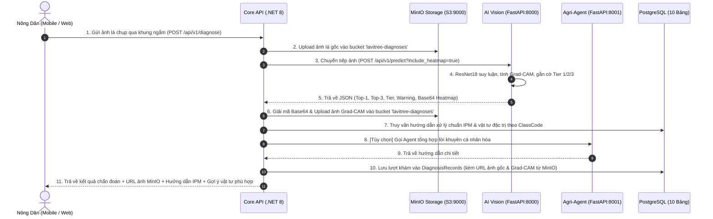

# 🏛️ THIẾT KẾ KIẾN TRÚC TỔNG THỂ HỆ THỐNG (SYSTEM-DESIGN.MD)
## Hệ thống Lavitree: Nông Nghiệp Thông Minh XAI & Tư Vấn Khuyến Nông
*Tài liệu chuẩn hóa bám sát mã nguồn thực tế trong repo LAVITREE*

---

## 1. SƠ ĐỒ KIẾN TRÚC TỔNG THỂ (HIGH-LEVEL ARCHITECTURE)

Hệ thống được thiết kế theo mô hình **Microservices định hướng miền (Domain-Driven Microservices)**, hỗ trợ triển khai cục bộ (Local Container Deployment) qua Docker Compose phục vụ môi trường ngoại tuyến.

> **Nguyên tắc Chuẩn hóa Dữ liệu (Single Source of Truth - SSOT)**: Toàn bộ cấu trúc JSON Request và Response giữa các phân hệ (Client $\leftrightarrow$ Core API $\leftrightarrow$ AI Vision & Agent) được quy định thống nhất và duy nhất tại [api-contracts.md](api-contracts.md). Các tài liệu khác chỉ đóng vai trò tham chiếu.

```text
┌────────────────────────────────────────────────────────────────────────┐
│                        TẦNG GIAO DIỆN (CLIENTS)                        │
│                                                                        │
│   [📱 Mobile Android App]                  [💻 Web Portal & Admin]     │
│   (Kotlin, Jetpack Compose, CameraX)       (React 18, Vite, TypeScript)│
└──────────────────┬─────────────────────────────────┬───────────────────┘
                   │                                 │
                   │ RESTful / JSON / Multipart      │
                   ▼                                 ▼
┌────────────────────────────────────────────────────────────────────────┐
│               TẦNG ĐIỀU PHỐI NGHIỆP VỤ (CORE GATEWAY)                 │
│                                                                        │
│   [⚙️ Core API Service] (ASP.NET Core 8 Web API - Port 5000:8080)       │
│   - Kiến trúc Clean Architecture, CQRS (MediatR), JWT Auth            │
│   - Quản lý Nghiệp vụ: Chẩn đoán, Đơn hàng, Tri thức, Lịch sử          │
│   - Điều phối luồng gọi AI & lưu vết kết quả xuống PostgreSQL          │
│   - Quản lý lưu trữ đối tượng qua S3 Client (MinIO Storage)            │
└───────┬──────────────────────┬───────────────────────────────┬─────────┘
        │                      │                               │
HTTP / Internal         HTTP / Internal                  S3 API / Internal
        ▼                      ▼                               ▼
┌──────────────────┐ ┌───────────────────────────────────────────┐ ┌─────────────────┐
│ AI VISION ENGINE │ │       AUTONOMOUS AGRI-AGENT SERVICE       │ │ OBJECT STORAGE  │
│ [🧠 AI Service]  │ │ [🤖 Agent Service] (FastAPI - Port 8001)  │ │ [📦 MinIO S3]   │
│ (FastAPI:8000)   │ │ - Vòng lặp ReAct (Thought-Action-Obs)     │ │ (Port 9000/9001)│
│ - ResNet-18      │ │ - MCP Server Tools (Weather, Store, PHI)  │ │ - Bucket:       │
│ - Grad-CAM XAI   │ │ - Boundary Guardrails (PHI, HITL - DAY 2) │ │   lavitree-     │
│ - Tier 1 / 2 / 3 │ │ - Waterfall Trace Log & Streaming SSE     │ │   diagnoses     │
└───────┬──────────┘ └─────────────────────┬─────────────────────┘ └─────────┬───────┘
        │                                  │                                 │
        └──────────────────────────────────┼─────────────────────────────────┘
                                           ▼
┌────────────────────────────────────────────────────────────────────────┐
│                   TẦNG DỮ LIỆU QUAN HỆ (PERSISTENCE)                   │
│                                                                        │
│   [🐘 PostgreSQL Database] (Port 5432 - Supabase / Local Container)    │
│   - 10 bảng chuẩn hóa 3NF: Diseases, Treatments, KnowledgeSources...   │
│   - Lưu trữ metadata và URL tham chiếu ảnh từ MinIO                    │
└────────────────────────────────────────────────────────────────────────┘
```

---

## 2. LUỒNG XỬ LÝ CHẨN ĐOÁN KHÉP KÍN (END-TO-END DIAGNOSIS PIPELINE)



---

## 3. CÁC NGUYÊN TẮC KIẾN TRÚC ĐẶC THÙ (ARCHITECTURAL PRINCIPLES)

1. **Cơ chế Fallback Ngoại Tuyến (Graceful Degradation - Kế thừa DAY 2)**:
   - Nếu mất kết nối internet hoặc không có LLM API Key: Hệ thống **tự động fallback về dữ liệu tĩnh** trong PostgreSQL (112 nguồn bài báo từ `KnowledgeSources_rows.csv` và hướng dẫn xử lý chuẩn IPM). Đảm bảo hội đồng chấm thi luôn xem được demo mà không phụ thuộc internet.
2. **Nguyên tắc "Cửa ngõ duy nhất" (Single Entrypoint Gateway)**:
   - Các ứng dụng Client (Web/Mobile) chỉ giao tiếp trực tiếp với `core-api:5000`. 
   - `ai-service` và `agent-service` là các microservices nội bộ (internal services) được bảo vệ, chỉ nhận lời gọi từ Core API.
3. **Cơ chế Chống Đoán Bừa (Uncertainty & Tiered Safeguard - Task 05)**:
   - Ảnh có điểm tin cậy $< 70\%$ hoặc thuộc Tier 2/3 bắt buộc phải đính kèm khuyến cáo người dùng chụp lại cận cảnh 15–20cm, không bao giờ khẳng định chắc nịch để bảo vệ mùa màng nông dân.

---

## 4. KIẾN TRÚC TÁC TỬ NÔNG NGHIỆP THÔNG MINH (AGRI-AGENT ARCHITECTURE)
*Hiện thực hóa toàn diện nghiên cứu 27 DAY từ thư mục `extract/` vào `backend/agent-service` (Port 8001)*

```text
       ┌────────────────────────────────────────────────────────┐
       │             CLIENT REQUEST (Web / Mobile)              │
       │    "Cà chua của tôi bị đốm nâu, 2 ngày nữa thu hoạch,  │
       │     chiều nay trời mưa thì nên xử lý thế nào?"         │
       └───────────────────────────┬────────────────────────────┘
                                   │
                                   ▼
┌──────────────────────────────────────────────────────────────────────┐
│        AGRI-AGENT SERVICE (FastAPI:8001) - REACT ENGINE              │
│                                                                      │
│  ┌────────────────────────────────────────────────────────────────┐  │
│  │ 1. BOUNDARY GUARDRAILS (DAY 2)                                 │  │
│  │ • Lọc Off-topic (chỉ nhận câu hỏi nông nghiệp cây trồng)        │  │
│  │ • Rà soát an toàn PHI (Sát ngày thu hoạch <= 3 ngày: CHẶN THUỐC)│  │
│  └───────────────────────────────┬────────────────────────────────┘  │
│                                  │                                   │
│  ┌───────────────────────────────▼────────────────────────────────┐  │
│  │ 2. VÒNG LẶP REACT (Reasoning + Acting - DAY 3)                 │  │
│  │                                                                │  │
│  │  THOUGHT 1: Cần kiểm tra thời tiết xem có mưa chiều nay không? │  │
│  │  ACTION 1:  Gọi MCP Tool `check_weather_risk(location="Hà Nam")│  │
│  │  OBSERV 1:  "Mưa rào 25mm vào 16:00, độ ẩm 90%"                 │  │
│  │                                                                │  │
│  │  THOUGHT 2: Trời mưa to -> hoãn phun thuốc. Cây thu hoạch sau  │  │
│  │             2 ngày -> vi phạm PHI thuốc hóa học (7 ngày).      │  │
│  │  ACTION 2:  Gọi MCP Tool `lookup_disease_knowledge` tìm biện   │  │
│  │             pháp sinh học/cơ học thay thế.                     │  │
│  │  OBSERV 2:  "Cắt tỉa lá bệnh, bôi vôi đặc, dùng Nano Bạc"      │  │
│  │                                                                │  │
│  │  FINAL:     Tổng hợp lời khuyên kèm thẻ [DRAFT_RECOMMENDATION] │  │
│  └───────────────────────────────┬────────────────────────────────┘  │
│                                  │                                   │
│  ┌───────────────────────────────▼────────────────────────────────┐  │
│  │ 3. TRUYỀN PHÁT & GIÁM SÁT SUY LUẬN (OBSERVABILITY)             │  │
│  │ • Streaming SSE (First Token < 0.4s) ra màn hình Chat          │  │
│  │ • Ghi nhận Waterfall Trace Log (DAY 3) vào `trace_waterfall.json│  │
│  └────────────────────────────────────────────────────────────────┘  │
└──────────────────────────────────────────────────────────────────────┘
```

### Danh mục 4 Công cụ MCP Chuẩn hóa (MCP Tool Catalog)
1. **`lookup_disease_knowledge`**:
   - Tham số: `disease_code` *(string)*, `query_type` *(string: symptoms | treatment | bio_alternative)*.
   - Đầu ra: Trích xuất tri thức chuẩn từ PostgreSQL / 112 bài báo đối chứng.
2. **`check_weather_risk`**:
   - Tham số: `location` *(string)*, `forecast_hours` *(int, default: 24)*.
   - Đầu ra: Tỷ lệ mưa, độ ẩm, sức gió và khuyến cáo phun thuốc (ĐẠT / NGUY CƠ RỬA TRÔI).
3. **`query_pesticide_store`**:
   - Tham số: `active_ingredient` *(string)*, `max_price` *(int, optional)*.
   - Đầu ra: Tên thương phẩm được phép lưu hành, quy cách gói, giá bán và tình trạng tồn kho.
4. **`verify_phi_safety`**:
   - Tham số: `harvest_days_left` *(int)*, `product_phi_days` *(int)*.
   - Đầu ra: `is_safe` *(boolean)*, `warning_message` *(string nếu vi phạm an toàn vệ sinh thực phẩm)*.

