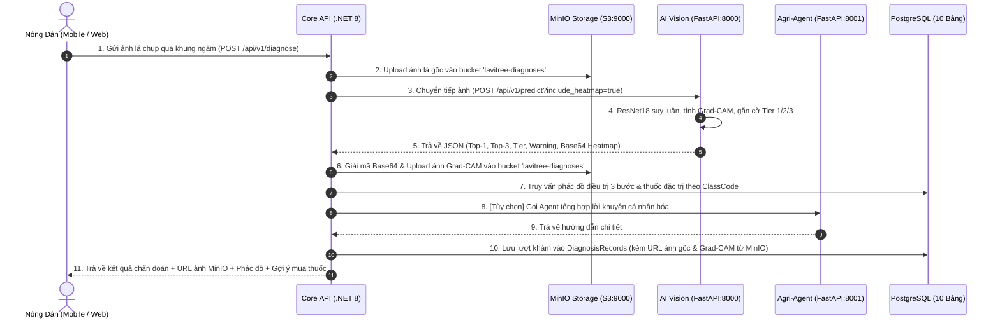

# 🏛️ THIẾT KẾ KIẾN TRÚC TỔNG THỂ HỆ THỐNG (SYSTEM-DESIGN.MD)
## Hệ thống Lavitree: Nông Nghiệp Thông Minh XAI & Tư Vấn Khuyến Nông
*Tài liệu chuẩn hóa bám sát mã nguồn thực tế trong repo LAVITREE*

---

## 1. SƠ ĐỒ KIẾN TRÚC TỔNG THỂ (HIGH-LEVEL ARCHITECTURE)

Hệ thống được thiết kế theo mô hình **Microservices định hướng miền (Domain-Driven Microservices)**, hỗ trợ vận hành **100% Offline qua Docker Compose**:

```text
┌────────────────────────────────────────────────────────────────────────┐
│                        TẦNG GIAO DIỆN (CLIENTS)                        │
│                                                                        │
│   [📱 Mobile Android App]                  [💻 Web Portal & Admin]     │
│   (Kotlin, Jetpack Compose, CameraX)       (React 18, Vite, TypeScript)│
└──────────────────┬─────────────────────────────────┬───────────────────┘
                   │                                 │
                   │ RESTful / JSON / Multipart      │
                   ▼                                 ▼
┌────────────────────────────────────────────────────────────────────────┐
│               TẦNG ĐIỀU PHỐI NGHIỆP VỤ (CORE GATEWAY)                 │
│                                                                        │
│   [⚙️ Core API Service] (ASP.NET Core 8 Web API - Port 5000:8080)       │
│   - Kiến trúc Clean Architecture, CQRS (MediatR), JWT Auth            │
│   - Quản lý Nghiệp vụ: Chẩn đoán, Đơn hàng, Tri thức, Lịch sử          │
│   - Điều phối luồng gọi AI & lưu vết kết quả xuống PostgreSQL          │
│   - Quản lý lưu trữ đối tượng qua S3 Client (MinIO Storage)            │
└───────┬──────────────────────┬───────────────────────────────┬─────────┘
        │                      │                               │
HTTP / Internal         HTTP / Internal                  S3 API / Internal
        ▼                      ▼                               ▼
┌──────────────────┐ ┌───────────────────────────────┐ ┌─────────────────┐
│ AI VISION ENGINE │ │      AGRI-AGENT SERVICE       │ │ OBJECT STORAGE  │
│ [🧠 AI Service]  │ │ [🤖 Agent Service] (Port 8001)│ │ [📦 MinIO S3]   │
│ (FastAPI:8000)   │ │ - RAG Tri thức (DAY 7, 8)     │ │ (Port 9000/9001)│
│ - ResNet18       │ │ - Dynamic Regimen (DAY 1)     │ │ - Bucket:       │
│ - Grad-CAM       │ │ - Boundary Guardrails (DAY 2) │ │   lavitree-     │
│ - Tier 1 / 2 / 3 │ │ - Streaming Chat SSE Advisor  │ │   diagnoses     │
└───────┬──────────┘ └─────────┬─────────────────────┘ └─────────┬───────┘
        │                      │                                 │
        └──────────────────────┼─────────────────────────────────┘
                               ▼
┌────────────────────────────────────────────────────────────────────────┐
│                   TẦNG DỮ LIỆU QUAN HỆ (PERSISTENCE)                   │
│                                                                        │
│   [🐘 PostgreSQL Database] (Port 5432 - Supabase / Local Container)    │
│   - 10 bảng chuẩn hóa 3NF: Diseases, Treatments, KnowledgeSources...   │
│   - Lưu trữ metadata và URL tham chiếu ảnh từ MinIO                    │
└────────────────────────────────────────────────────────────────────────┘
```

---

## 2. LUỒNG XỬ LÝ CHẨN ĐOÁN KHÉP KÍN (END-TO-END DIAGNOSIS PIPELINE)



---

## 3. CÁC NGUYÊN TẮC KIẾN TRÚC ĐẶC THÙ (ARCHITECTURAL PRINCIPLES)

1. **Cơ chế Fallback Ngoại Tuyến (Graceful Degradation - Kế thừa DAY 2)**:
   - Nếu mất kết nối internet hoặc không có LLM API Key: Hệ thống **tự động fallback về dữ liệu tĩnh** trong PostgreSQL (112 nguồn bài báo từ `KnowledgeSources_rows.csv` và phác đồ 3 bước chuẩn hóa). Đảm bảo hội đồng chấm thi luôn xem được demo mà không phụ thuộc internet.
2. **Nguyên tắc "Cửa ngõ duy nhất" (Single Entrypoint Gateway)**:
   - Các ứng dụng Client (Web/Mobile) chỉ giao tiếp trực tiếp với `core-api:5000`. 
   - `ai-service` và `agent-service` là các microservices nội bộ (internal services) được bảo vệ, chỉ nhận lời gọi từ Core API.
3. **Cơ chế Chống Đoán Bừa (Uncertainty & Tiered Safeguard - Task 05)**:
   - Ảnh có điểm tin cậy $< 70\%$ hoặc thuộc Tier 2/3 bắt buộc phải đính kèm khuyến cáo người dùng chụp lại cận cảnh 15–20cm, không bao giờ khẳng định chắc nịch để bảo vệ mùa màng nông dân.
