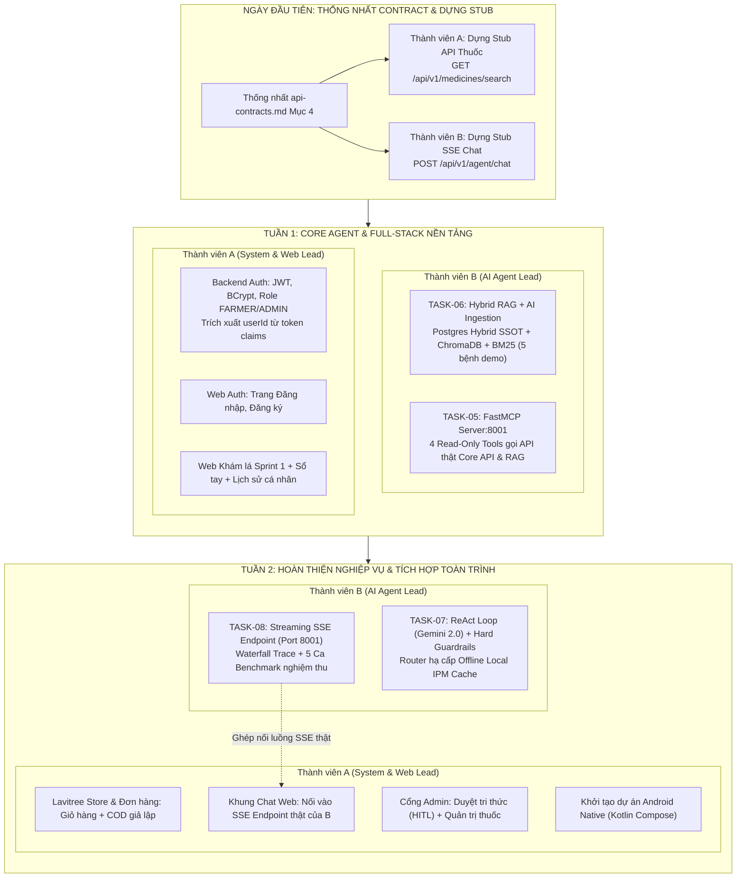

# 🧠 KẾ HOẠCH SPRINT 2: SONG HÀNH TÁC TỬ NÔNG NGHIỆP (AGENT B) & HÌNH THÀNH HỆ THỐNG TOÀN DIỆN (SYSTEM & WEB A)
## Thời gian dự kiến: Tuần 2 (2 Tuần thực thi cân bằng cho Nhóm 2 Người)
*Hiện thực hóa song song: Bộ não AI Agent (FastAPI:8001) & Trục Nghiệp vụ Web/Auth/Store (.NET 8 + React)*

---

### 1. 🎯 MỤC TIÊU SPRINT (SPRINT GOAL)
Xây dựng và kết nối hoàn chỉnh 2 trụ cột của hệ thống Lavitree:
1. **Phân hệ Tác tử Nông nghiệp Thông minh (Member B)**: Vận hành độc lập trên cổng **`8001`**, sở hữu chu trình ReAct Loop (Gemini 2.0/2.5 Flash), tầng tri thức Hybrid RAG (PostgreSQL SSOT + ChromaDB + BM25 trên 5 ca bệnh demo), bộ công cụ FastMCP Read-Only, chốt chặn an toàn bằng code cứng (Hard Guardrails $DaysToHarvest \le PhiDays$), router hạ cấp ngoại tuyến cục bộ và streaming SSE thời gian thực.
2. **Hình thành Hệ thống Web & Nghiệp vụ Nông nghiệp Thực tế (Member A)**: Chuyển hóa toàn bộ kết quả Sprint 1 & các Use Cases cốt lõi thành sản phẩm tương tác thực: Hệ thống Xác thực JWT/BCrypt (bảo mật `userId` từ token), Web Khám lá kèm Heatmap Grad-CAM & Phác đồ IPM, Sổ tay bệnh học, Lịch sử chẩn đoán cá nhân, Cửa hàng & Đơn hàng vật tư nông nghiệp (COD giả lập), Cổng Admin duyệt tri thức (HITL), và khởi tạo dự án Android Native.

> **Quy chuẩn Giao tiếp & Ranh giới Nghiệp vụ (SSOT & Safety Boundaries)**:
> 1. **Nguyên tắc "Ngày Đầu Tiên — 0 Phút Chờ Đợi" (Contract-First & Mock Stub)**:
>    - Thành viên A cung cấp Stub API Thuốc `GET /api/v1/medicines/search` ngay ngày đầu để B làm RAG & MCP.
>    - Thành viên B cung cấp Stub SSE Chat `POST /api/v1/agent/chat` ngay ngày đầu để A dựng giao diện Web.
>    - Hai bên code độc lập 100%, cuối tuần 2 ghép nối chính thức.
> 2. **Cổng dịch vụ chuẩn (Port Binding)**: `backend/agent-service` bind cổng **`8001`** (đồng bộ với `docker-compose.yml` và `api-contracts.md` Mục 4).
> 3. **PostgreSQL là Nguồn sự thật Duy nhất (SSOT)**: Lưu trữ Hybrid: trường cấu trúc lọc cứng (`phi_days`, `is_allowed`, `active_ingredients`) song song với `full_content TEXT` và `chunks JSONB`. ChromaDB cục bộ và BM25 là chỉ mục phái sinh có thể tái tạo (rebuildable).
> 4. **Bảo mật Định danh (Auth Security)**: `userId` bắt buộc trích xuất từ JWT Claims, xóa bỏ hoàn toàn việc truyền `userId` từ form-data.
> 5. **Chốt chặn an toàn bằng Code (Hard Guardrails)**: Lọc thuốc vi phạm PHI và thuốc bị cấm bằng hàm Python trước khi vào prompt LLM; không trông cậy vào việc LLM tự nhớ gọi tool.
> 6. **Cắt tỉa Nghiệp vụ Thông minh (Scope Pruning)**:
>    - *Tạm hoãn / Bỏ qua*: Kho nhiều chi nhánh, thanh toán VietQR thật (dùng COD giả lập là chuẩn đồ án), lập kế hoạch chăm sóc cây khỏe.
>    - *Thu nhỏ*: Chuyển ca chuyên gia (chỉ gắn cờ `requires_expert: true` trên trang Admin, không làm chat realtime WebSocket).
>    - *Làm sớm Android*: Khởi tạo project Android Native từ tuần 2 để Sprint 3 không bị quá tải.

---

### 2. 🗺️ MA TRẬN KẾ THỪA TỪ KHO NGUYÊN MẪU `extract/`

| Hạng mục trong Sprint 2 | DAY kế thừa | Module / File nguyên mẫu cụ thể từ `extract/` | Mục đích & Cách tích hợp vào Lavitree |
| :--- | :---: | :--- | :--- |
| **Kiến trúc MCP Server** | **DAY3, DAY26** | `DAY3/lavitree_mcp_server.py` `DAY26/lavitree_mcp_architecture.py` | Xương sống MCP: Tách rời Tools khỏi LLM, công bố 4 Tool Schemas chuẩn JSON Schema / FastMCP, kết nối REST API Core API & Weather Service (cache 1h). |
| **Quy tắc An toàn & Ranh giới** | **DAY2, DAY4** | `DAY2/BAOCAO_DAY2.md` `DAY4/prompt.md` | Ranh giới AI: Chặn ghi (Read-only), lọc bỏ thuốc cấm, phát hiện câu hỏi ngoài nông nghiệp, từ chối khẳng định khi thiếu dữ liệu. |
| **Tầng Tri thức Hybrid RAG** | **DAY7, DAY8, DAY18** | `DAY18/lavitree_production_rag_pipeline.py` `extract/KnowledgeSources_rows.csv` | Kết hợp BM25 (bắt chính xác tên thuốc như *Mancozeb*, tỷ lệ pha) + Dense Vector (ChromaDB cục bộ ngữ nghĩa triệu chứng) trên 5 bệnh demo. |
| **Chốt chặn PHI & HITL** | **DAY2, DAY11, DAY27** | `DAY3/lavitree_react_agent.py` `DAY27/lavitree_hitl_orchestration.py` | Logic code Python kiểm soát $DaysToHarvest \le PhiDays$. Báo động đỏ và loại bỏ thuốc hóa học. Gắn nhãn `[DRAFT_RECOMMENDATION]`. |
| **Tự phục hồi & Hạ cấp Ngoại tuyến** | **DAY25, DAY27** | `DAY25/lavitree_reliability_resilience.py` `DAY27/BAOCAO_DAY27.md` | Circuit Breaker & Caching (1h cho thời tiết). Router Graceful Degradation tự động fallback về gói phác đồ tĩnh IPM cục bộ khi rớt mạng. |
| **Streaming & Minh bạch Suy luận** | **DAY1, DAY3, DAY13** | `DAY3/lavitree_trace_waterfall.json` `DAY1/BAOCAO_DAY1.md` | Streaming token thời gian thực bằng SSE (`POST /api/v1/agent/chat`). Xuất file `trace_waterfall.json` đo độ trễ từng bước suy luận. |
| **Đánh giá Định lượng Đồ án** | **DAY14, DAY24, DAY26** | `DAY26/lavitree_mcp_benchmark.py` `DAY27/lavitree_hitl_benchmark.py` | Chạy bộ 5 ca lâm sàng kiểm thử tự động (mỗi ca 3 lần ở `temperature=0`), sinh báo cáo Benchmark phục vụ Hội đồng chấm thi. |

---

### 3. 👥 PHÂN CÔNG TRÁCH NHIỆM (TEAM ROLES & OWNERSHIP)

---

### 4. 📋 DANH SÁCH TASKS CHI TIẾT SPRINT 2 THEO TỪNG THÀNH VIÊN

#### 👨‍💻 NHÓM VIỆC CỦA THÀNH VIÊN B (AI AGENT LEAD)

- [ ] **TASK-06: Tầng Tri thức Hybrid RAG (BM25 + ChromaDB) & Ingestion Pipeline Kiểm định** *(Ưu tiên 1 - Tuần 1)*
  - *Nội dung*:
    1. Thiết kế bảng tri thức Postgres mô hình Hybrid (trường cấu trúc lọc cứng + `full_content TEXT` + `chunks JSONB`).
    2. AI Ingestion hỗ trợ Admin bóc tách bài viết/URL thành bản ghi Staging có duyệt (`IsManualApproved = true`).
    3. Tự động đồng bộ từ Postgres sang ChromaDB cục bộ (Vector Search) và BM25 Okapi (từ khóa hoạt chất) cho 5 bệnh demo.
    4. Hợp nhất thứ hạng RRF ($k=60$), đạt Recall@3 đối chứng 100%.

- [ ] **TASK-05: Thiết lập `backend/agent-service:8001` & Cấu trúc Model Context Protocol (FastMCP Server)** *(Ưu tiên 2 - Tuần 1)*
  - *Nội dung*:
    1. Khởi tạo FastAPI microservice trên cổng **`8001`**.
    2. Định nghĩa 4 công cụ chuẩn FastMCP (Read-Only): `lookup_disease_knowledge` (gọi Task 06), `check_weather_risk` (Core API có cache 1h), `query_pesticide_store` (Core API thuốc), `verify_phi_safety` (logic Python an toàn $DaysToHarvest \le PhiDays$).
    3. Đảm bảo toàn bộ tools đều là Read-only, không có quyền ghi/sửa CSDL.

- [ ] **TASK-07: Vòng lặp ReAct Loop, Bộ Chốt chặn An toàn (Hard Guardrails) & Router Hạ cấp Ngoại tuyến** *(Ưu tiên 3 - Tuần 2)*
  - *Nội dung*:
    1. Vòng lặp ReAct: `Thought → Action → Observation → Final Answer` với mô hình **Gemini 2.0 / 2.5 Flash** (max iterations = 5).
    2. **Hard Code Guardrails bằng Python**: Tiền lọc thuốc cấm & vi phạm PHI bằng code cứng trước khi nạp vào prompt LLM; hậu kiểm quét chuỗi câu trả lời cuối cùng.
    3. Gắn nhãn bản thảo `[DRAFT_RECOMMENDATION]`.
    4. Circuit Breaker & Router tự động hạ cấp về tệp phác đồ tĩnh IPM lưu cục bộ (`offline_ipm_cache.json`) trong $< 1.0$s khi rớt mạng.

- [ ] **TASK-08: Triển khai Streaming SSE, Waterfall Trace Logging & Benchmark Nghiệm thu 5 Ca Lâm sàng** *(Ưu tiên 4 - Tuần 2)*
  - *Nội dung*:
    1. Endpoint `POST /api/v1/agent/chat` (port 8001) chuẩn SSOT `api-contracts.md` Mục 4.1 (`trace_start`, `thought`, `action`, `observation`, `delta`, `final_answer`).
    2. Time-to-First-Thought $\le 2.0$s; xuất file `trace_waterfall.json` đo độ trễ từng bước.
    3. Chạy tự động bộ benchmark 5 ca lâm sàng (mỗi ca chạy 3 lần ở `temperature=0`) đạt 15/15 PASS.

---

#### 👨‍💻 NHÓM VIỆC CỦA THÀNH VIÊN A (SYSTEM, AUTH & WEB FRONTEND LEAD)

- [ ] **TASK-A00: Nền tảng Giao diện — Tailwind v4, shadcn/ui & Design Tokens** *(P0 - Đầu Tuần 1, làm trước A02–A04)*
  - *Nội dung*:
    1. Cài Tailwind v4 + shadcn/ui, khai báo token màu/chữ, font Be Vietnam Pro tự host.
    2. Dựng khung trang `AppShell` / `AdminShell`, router, trang 404/403, thành phần dùng chung và `ResultStatusBadge`.
    3. Đồng bộ theme Android (Material 3) với cùng bảng màu.
  - *Chi tiết*: [tasks/sprint-02/task-A00-ui-foundation.md](../../tasks/sprint-02/task-A00-ui-foundation.md)

> 📐 **Tài liệu giao diện bắt buộc cho TASK-A00 → A04**: [docs/architecture/ui-ux.md](../architecture/ui-ux.md) (design system) và [docs/spec/screens.md](../spec/screens.md) (màn hình, điều hướng, quy tắc hiển thị).

- [ ] **TASK-A01: Module Xác thực, Phân quyền JWT & Vá Bảo mật Core API** *(P0 - Tuần 1)*
  - *Nội dung*:
    1. Xây dựng `AuthController.cs`: `POST /api/v1/auth/register`, `POST /api/v1/auth/login` (sinh JWT Token, băm mật khẩu bằng BCrypt, phân vai `FARMER` / `ADMIN`).
    2. Bảo mật định danh: Trích xuất `userId` từ JWT Claims cho endpoint chẩn đoán, xóa bỏ lỗ hổng nhận `userId` từ form-data.
    3. Cung cấp ngay **Stub API Thuốc** `GET /api/v1/medicines/search` cho Thành viên B.

- [ ] **TASK-A02: Hoàn thiện Web Portal Khám lá E2E, Sổ tay Bệnh học & Lịch sử Cá nhân** *(P0 - Tuần 1)*
  - *Nội dung*:
    1. Xây dựng trang Đăng nhập / Đăng ký trên Web (`LoginPage.tsx`, `RegisterPage.tsx`), lưu JWT và phân quyền giao diện.
    2. Hoàn thiện trang Khám lá (`DiagnosePage.tsx`): Tải ảnh $\rightarrow$ Core API $\rightarrow$ Hiển thị kết quả ResNet-18, Heatmap Grad-CAM, mẹo chụp ảnh khi bất định (`is_uncertain`) và phác đồ IPM.
    3. Xây dựng trang Lịch sử cá nhân (`HistoryPage.tsx`): Gọi `GET /api/v1/diagnoses/my-history` xem lại danh sách các ca khám lá của nông dân.
    4. Hoàn thiện trang Sổ tay bệnh học (`HandbookPage.tsx`): Tra cứu 14 loài cây và 40 lớp bệnh học.

- [ ] **TASK-A03: Phân hệ Cửa hàng Vật tư Nông nghiệp & Cổng Admin Quản trị Tri thức** *(P1 - Tuần 2)*
  - *Nội dung*:
    1. Xây dựng tính năng Cửa hàng Lavitree Store (`StorePage.tsx`): Xem danh mục thuốc BVTV, thêm vào giỏ hàng, tạo đơn hàng với hình thức thanh toán COD giả lập (`POST /api/v1/orders`).
    2. Xây dựng Cổng Admin Quản trị (`AdminDashboard.tsx`): Xem danh sách bài viết khuyến nông, duyệt bài (`IsManualApproved = true`), cập nhật kho thuốc, và xem danh sách các ca bệnh cần chuyên gia hỗ trợ (`requires_expert = true`).

- [ ] **TASK-A04: Tích hợp Khung Chat Web Streaming SSE & Khởi tạo Dự án Android Native** *(P1 - Tuần 2)*
  - *Nội dung*:
    1. Dựng giao diện Khung chat Trợ lý Cây trồng trên Web: Ban đầu kết nối với Mock SSE Stub của B; đến cuối tuần 2 ghép nối với endpoint SSE thật từ Task 08.
    2. Khởi tạo cấu trúc dự án Android Native (`mobile/android/`) bằng Kotlin & Jetpack Compose, cấu hình thư viện CameraX và Retrofit, dựng sẵn khung 2 màn hình chính (Khám lá & Chat).

---

### 5. 🎯 BƯỚC ĐỆM CHO SPRINT 3: TỐI ƯU HÓA, ĐÓNG GÓI & DIỄN TẬP BẢO VỆ
Nhờ Sprint 2 đã hoàn thành toàn bộ khung sườn sản phẩm (Vertical Slices: Web + Auth + Store + Agent), **Sprint 3** sẽ không còn bị dồn việc mà tập trung vào các tiêu chuẩn chất lượng cao:
1. **TASK-09 (Tối ưu hóa Web Portal)**: Tối ưu UI/UX, responsive mượt mà trên mobile, loading skeleton, bảo mật token chống XSS.
2. **TASK-10 (Hoàn thiện Android App Native)**: Kết nối trọn vẹn CameraX chụp ảnh lá $\rightarrow$ Core API $\rightarrow$ Hiển thị kết quả và Chat SSE với Agent trên điện thoại Android thật.
3. **TASK-11 (Màn hình Admin Observability)**: Trực quan hóa cây suy luận Waterfall Chart phục vụ Hội đồng chấm thi.
4. **TASK-12 (Docker Compose 1-Click & Diễn tập Bảo vệ)**: Đóng gói container dự phòng demo offline hoàn hảo và diễn tập kịch bản vấn đáp tốt nghiệp.
5. **TASK-13 (Nghiệm thu OOD)**: Đo đạc số liệu OOD chính thức trên 3 tập dữ liệu độc lập cho quyển báo cáo tốt nghiệp.
