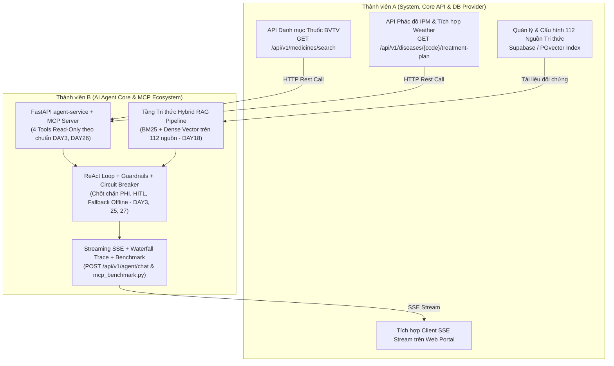

# 🧠 KẾ HOẠCH SPRINT 2: TRỌNG TÂM TRÍ TUỆ NHÂN TẠO TÁC TỬ (AGRI-AGENT & MCP ECOSYSTEM)
## Thời gian dự kiến: Tuần 2 — Kế hoạch thực thi cho Nhóm 2 Người
*Hiện thực hóa toàn diện kho nghiên cứu 27 DAY từ `extract/` vào `backend/agent-service` (FastAPI)*

---

### 1. 🎯 MỤC TIÊU SPRINT (SPRINT GOAL)
Xây dựng phân hệ Trợ lý Tác tử Nông nghiệp Thông minh (**Lavitree Agri-Agent**) độc lập dựa trên kiến trúc **ReAct Loop** (`Thought → Action → Observation → Final Answer`) kết nối hệ sinh thái **Model Context Protocol (MCP)**. Tác tử giải quyết các ca bệnh thực tế ngoài vườn thông qua việc tích hợp đa nguồn: Tra cứu tri thức chuẩn khuyến nông (Hybrid RAG trên 112 tài liệu), kiểm tra thời tiết thời gian thực, đối soát kho thuốc BVTV, chốt chặn an toàn thời gian cách ly (PHI $\le 3$ ngày) và tự phục hồi/hạ cấp ngoại tuyến khi rớt mạng.

> **Quy chuẩn Giao tiếp & Ranh giới Nghiệp vụ (SSOT & Safety Boundaries)**:
> 1. **Hợp đồng API chuẩn**: Toàn bộ endpoint của `agent-service` tuân thủ Mục 4 trong [docs/architecture/api-contracts.md](../architecture/api-contracts.md).
> 2. **Nguyên tắc "Chặn ghi" (Read-only Agent - DAY4)**: Agent chỉ được cấp quyền đọc dữ liệu, tuyệt đối không được cấp tool tự động tạo đơn mua hàng hay thay đổi database.
> 3. **Nhãn khuyến nghị bản thảo (HITL - DAY11, DAY27)**: Mọi đơn thuốc đề xuất phải gắn nhãn `[DRAFT_RECOMMENDATION]` để Bác sĩ Cây trồng hoặc Nông dân chủ động duyệt.
> 4. **Khả năng tự phục hồi (Resilience - DAY25, DAY27)**: Khi LLM hoặc API thời tiết lỗi/mất mạng, Circuit Breaker kích hoạt Router hạ cấp ngoại tuyến, trả về phác đồ tĩnh IPM từ CSDL Supabase/PostgreSQL.

---

### 2. 🗺️ MA TRẬN KẾ THỪA TỪ KHO NGUYÊN MẪU `extract/`

| Hạng mục trong Sprint 2 | DAY kế thừa | Module / File nguyên mẫu cụ thể từ `extract/` | Mục đích & Cách tích hợp vào Lavitree |
| :--- | :---: | :--- | :--- |
| **Kiến trúc MCP Server** | **DAY3, DAY26** | `DAY3/lavitree_mcp_server.py` `DAY26/lavitree_mcp_architecture.py` | Xương sống MCP: Tách rời Tools khỏi LLM, công bố 4 Tool Schemas chuẩn JSON Schema, thay thế mock dicts bằng REST API gọi Core API & Supabase. |
| **Quy tắc An toàn & Ranh giới** | **DAY2, DAY4** | `DAY2/BAOCAO_DAY2.md` `DAY4/prompt.md` | Ranh giới AI: Chặn ghi (Read-only), phát hiện câu hỏi ngoài nông nghiệp, từ chối khẳng định khi thiếu dữ liệu. |
| **Tầng Tri thức Hybrid RAG** | **DAY7, DAY8, DAY18** | `DAY18/lavitree_production_rag_pipeline.py` `extract/KnowledgeSources_rows.csv` | Kết hợp BM25 (bắt chính xác tên thuốc như *Mancozeb*, tỷ lệ pha) + Dense Vector (ngữ nghĩa triệu chứng) trên 112 tài liệu khuyến nông. |
| **Chốt chặn PHI & HITL** | **DAY2, DAY11, DAY27** | `DAY3/lavitree_react_agent.py` `DAY27/lavitree_hitl_orchestration.py` | Báo động đỏ khi số ngày đến vụ thu hoạch $\le$ thời gian cách ly của thuốc. Gắn tag `[DRAFT_RECOMMENDATION]`. |
| **Tự phục hồi & Hạ cấp Ngoại tuyến** | **DAY25, DAY27** | `DAY25/lavitree_reliability_resilience.py` `DAY27/BAOCAO_DAY27.md` | Circuit Breaker & Caching (1h cho thời tiết). Router Graceful Degradation tự động fallback về phác đồ tĩnh IPM khi rớt mạng. |
| **Streaming & Minh bạch Suy luận** | **DAY1, DAY3, DAY13** | `DAY3/lavitree_trace_waterfall.json` `DAY1/BAOCAO_DAY1.md` | Streaming token thời gian thực bằng SSE (`POST /api/v1/agent/chat`). Xuất file `trace_waterfall.json` đo độ trễ từng bước. |
| **Đánh giá Định lượng Đồ án** | **DAY14, DAY24, DAY26** | `DAY26/lavitree_mcp_benchmark.py` `DAY27/lavitree_hitl_benchmark.py` | Chạy 5 ca lâm sàng kiểm thử tự động, sinh báo cáo Benchmark phục vụ Hội đồng chấm thi. |

---

### 3. 👥 PHÂN CÔNG TRÁCH NHIỆM (TEAM ROLES & OWNERSHIP)

| Thành viên | Trách nhiệm chính (Owner) | Deliverables Sprint 2 |
| :--- | :--- | :--- |
| **Thành viên A (System & Backend / Frontend)** | • Viết các API Endpoint trên Core API (.NET 8) cấp dữ liệu thật về thuốc và phác đồ cho MCP Tools • Tích hợp OpenWeatherMap API với cơ chế Cache 1 giờ trong Memory/Redis • Cấu hình bảng `KnowledgeSources` và hỗ trợ vector storage trên Supabase • Xây dựng giao diện Client nhận SSE Streaming trên Web Portal | • Core API cung cấp 2 endpoints RESTful cho MCP Server • API thời tiết hoạt động ổn định có cache • Khung chat Web Portal nhận stream chữ mượt mà |
| **Thành viên B (AI Agent & RAG Specialist)** | • Thiết lập `backend/agent-service` (FastAPI) chuẩn hóa 4 MCP Tools (Read-Only) • Xây dựng module Hybrid RAG (BM25 + Vector) trên 112 tài liệu khuyến nông (`KnowledgeSources_rows.csv`) • Cài đặt ReAct Loop hoàn chỉnh kèm bộ 3 chốt chặn an toàn (PHI, HITL, Max Iterations) và Circuit Breaker/Router hạ cấp • Hoàn thiện SSE Streaming `POST /api/v1/agent/chat`, xuất `trace_waterfall.json` và chạy bộ benchmark | • Service `backend/agent-service` vận hành độc lập trên port 8002 • 4 MCP Tools gọi dữ liệu thật từ Core API • Bộ chốt chặn PHI từ chối 100% thuốc độc sát ngày thu hoạch • Xuất file `trace_waterfall.json` và bộ kết quả benchmark nghiệm thu |

---

### 4. 📋 DANH SÁCH TASKS CHI TIẾT SPRINT 2

- [ ] **TASK-05: Thiết lập `backend/agent-service` & Cấu trúc Model Context Protocol (MCP Server)**
  - *Trách nhiệm*: **Thành viên B** (phối hợp Thành viên A về API Core)
  - *Kế thừa*: `extract/DAY3/lavitree_mcp_server.py` & `extract/DAY26/lavitree_mcp_architecture.py`.
  - *Nội dung*:
    1. Khởi tạo dịch vụ FastAPI tại `backend/agent-service` (port 8002).
    2. Định nghĩa 4 công cụ theo chuẩn JSON Schema: `lookup_disease_knowledge`, `check_weather_risk`, `query_pesticide_store`, `verify_phi_safety`.
    3. Áp dụng nguyên tắc **Read-Only Tools** (DAY4): Tuyệt đối không cho phép tạo/sửa đơn hàng.
    4. Thành viên A cung cấp endpoint Core API: `GET /api/v1/medicines/search` và Service thời tiết (kèm cache 1h).

- [ ] **TASK-06: Tầng Tri thức Hybrid RAG (BM25 + Dense Vector) trên 112 Nguồn Khuyến Nông**
  - *Trách nhiệm*: **Thành viên B** (phối hợp Thành viên A về CSDL)
  - *Kế thừa*: `extract/DAY18/lavitree_production_rag_pipeline.py` & `extract/KnowledgeSources_rows.csv`.
  - *Nội dung*:
    1. Xử lý phân đoạn (Chunking) 112 tài liệu khuyến nông theo tiêu chuẩn nông nghiệp: Tên bệnh, Hoạt chất đặc trị, Liều lượng, Thời gian cách ly PHI.
    2. Tích hợp chỉ mục **BM25 Okapi** để tìm kiếm chính xác tuyệt đối tên hoạt chất thuốc (*Mancozeb*, *Metalaxyl*, *Difenoconazole*...).
    3. Tích hợp chỉ mục **Dense Vector** để truy xuất ngữ nghĩa biểu hiện bệnh lý.
    4. Hợp nhất kết quả bằng **Reciprocal Rank Fusion (RRF)** trả về ngữ cảnh chuẩn xác cho tool `lookup_disease_knowledge`.

- [ ] **TASK-07: Vòng lặp ReAct, Bộ Chốt chặn An toàn (Guardrails) & Router Tự phục hồi / Hạ cấp**
  - *Trách nhiệm*: **Thành viên B**
  - *Kế thừa*: `extract/DAY3/lavitree_react_agent.py`, `extract/DAY25/lavitree_reliability_resilience.py`, `extract/DAY27/lavitree_hitl_orchestration.py`.
  - *Nội dung*:
    1. Vòng lặp ReAct: `Thought → Action → Observation → Final Answer` với giới hạn `max_iterations = 5`.
    2. **Chốt chặn PHI (DAY2, DAY3)**: Nếu $DaysToHarvest \le PHI$, Agent kích hoạt cảnh báo đỏ, từ chối thuốc hóa học và chuyển sang phác đồ sinh học/canh tác.
    3. **Chốt chặn HITL (DAY11, DAY27)**: Mọi đơn thuốc phải gắn tag `[DRAFT_RECOMMENDATION]`.
    4. **Circuit Breaker & Graceful Degradation Router (DAY25, DAY27)**: Khi LLM/API thời tiết lỗi hoặc mất mạng, tự động hạ cấp về phác đồ tĩnh IPM từ CSDL Supabase/PostgreSQL.

- [ ] **TASK-08: Triển khai Streaming SSE, Waterfall Trace Logging & Benchmark Nghiệm thu Đồ án**
  - *Trách nhiệm*: **Thành viên B & Thành viên A**
  - *Kế thừa*: `extract/DAY1`, `extract/DAY3/lavitree_trace_waterfall.json`, `extract/DAY26/lavitree_mcp_benchmark.py`.
  - *Nội dung*:
    1. Endpoint `POST /api/v1/agent/chat` truyền phát token thời gian thực qua giao thức **Server-Sent Events (SSE)**.
    2. Module ghi vết suy luận tự động xuất file `trace_waterfall.json` ghi lại thời gian chạy từng tool ($ms$) và số token.
    3. Chạy bài benchmark tự động trên 5 ca lâm sàng thực tế ngoài vườn để xuất báo cáo nghiệm thu phục vụ Hội đồng chấm thi.
    4. Thành viên A kiểm thử kết nối E2E giữa Web Client và Agent Service.

---

### 5. 🛡️ TIÊU CHÍ NGHIỆM THU SPRINT (QUALITY GATES SPRINT 2)

1. **Gate 1 - Real Data MCP Protocol**:
   - 4 MCP Tools thực thi 100% trên dữ liệu thật (Core API + Supabase DB + Live Weather API có cache), không còn sử dụng dữ liệu giả lập (mock dicts).
   - Tuyệt đối không tồn tại tool có quyền ghi/sửa database (Read-only enforcement).
2. **Gate 2 - Hybrid RAG Accuracy**:
   - Truy vấn thuốc đặc trị ra đúng 100% hoạt chất đối chứng từ 112 nguồn khuyến nông thông qua cơ chế BM25 kết hợp Vector Search. Không sinh ảo giác hoạt chất bị cấm hoặc sai nồng độ.
3. **Gate 3 - Zero-Tolerance PHI Safety & Offline Fallback**:
   - 100% ca thử nghiệm cận ngày thu hoạch ($DaysToHarvest \le PHI$) phải kích hoạt từ chối thuốc hóa học và cảnh báo đỏ.
   - Khi ngắt kết nối internet hoặc tắt API thời tiết: Agent không crash mà tự kích hoạt Router hạ cấp, trả về kết quả phác đồ IPM từ CSDL trong $< 1.0$ giây.
4. **Gate 4 - SSE Streaming & Observability**:
   - `POST /api/v1/agent/chat` truyền phát ký tự đầu tiên (Time-to-First-Token) trong $\le 2.0$ giây.
   - Xuất file `trace_waterfall.json` với cấu trúc cây suy luận minh bạch 100%.
