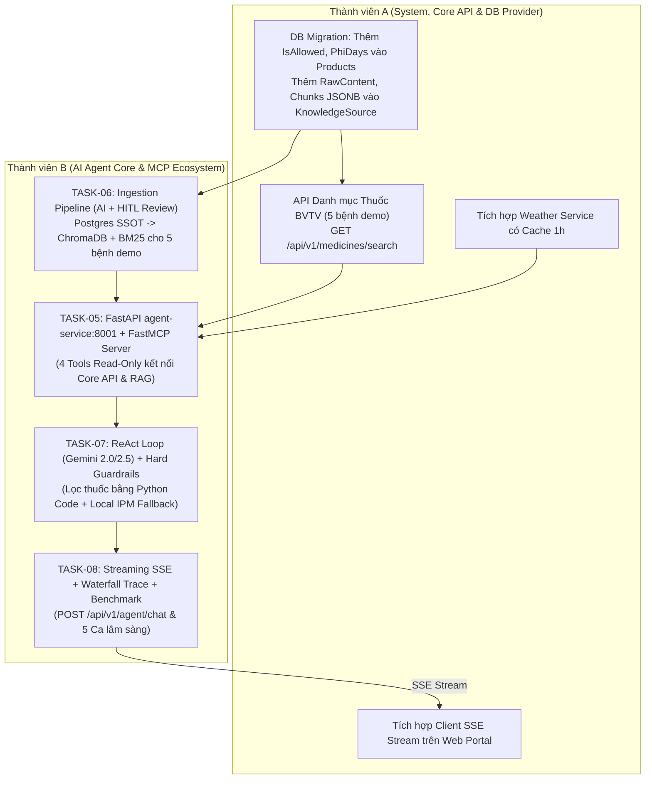

# 🧠 KẾ HOẠCH SPRINT 2: TRỌNG TÂM TRÍ TUỆ NHÂN TẠO TÁC TỬ (AGRI-AGENT & MCP ECOSYSTEM)
## Thời gian dự kiến: Tuần 2 — Kế hoạch thực thi cho Nhóm 2 Người
*Hiện thực hóa toàn diện kho nghiên cứu 27 DAY từ `extract/` vào `backend/agent-service` (FastAPI:8001)*

---

### 1. 🎯 MỤC TIÊU SPRINT (SPRINT GOAL)
Xây dựng phân hệ Trợ lý Tác tử Nông nghiệp Thông minh (**Lavitree Agri-Agent**) độc lập dựa trên kiến trúc **ReAct Loop** (`Thought → Action → Observation → Final Answer`) kết nối hệ sinh thái **Model Context Protocol (MCP)**. Tác tử giải quyết các ca bệnh thực tế ngoài vườn thông qua việc tích hợp đa nguồn: Tra cứu tri thức chuẩn khuyến nông (Hybrid RAG kết hợp BM25 + Vector Search), kiểm tra thời tiết thời gian thực, đối soát kho thuốc BVTV, chốt chặn an toàn thời gian cách ly (PHI bảo thủ: $DaysToHarvest \le PhiDays$) và tự phục hồi/hạ cấp ngoại tuyến khi rớt mạng.

> **Quy chuẩn Giao tiếp & Ranh giới Nghiệp vụ (SSOT & Safety Boundaries)**:
> 1. **Cổng dịch vụ chuẩn (Port Binding)**: `backend/agent-service` vận hành độc lập trên cổng **`8001`** (đồng bộ tuyệt đối với `docker-compose.yml` và hợp đồng `docs/architecture/api-contracts.md` Mục 4).
> 2. **Hợp đồng API chuẩn (SSOT)**: Toàn bộ endpoint của `agent-service` tuân thủ Mục 4.1 trong `api-contracts.md` (Payload: `message`, `conversation_id`, `harvest_days_left`; SSE Events: `trace_start`, `thought`, `action`, `observation`, `delta`, `final_answer`).
> 3. **PostgreSQL là Nguồn sự thật Duy nhất (SSOT)**: Lưu trữ kết hợp trường có cấu trúc để lọc cứng (`phi_days`, `is_allowed`, `active_ingredients`) và trường văn bản thô + chunks (`full_content TEXT`, `chunks JSONB`). ChromaDB cục bộ và BM25 là các chỉ mục phái sinh có thể tái lập (rebuildable) từ Postgres.
> 4. **Nguyên tắc "Chặn ghi" (Read-only Agent - DAY4)**: Toàn bộ công cụ của Agent chỉ có quyền đọc dữ liệu, tuyệt đối không được cấp quyền tự động tạo đơn hàng hay thay đổi database.
> 5. **Nhãn khuyến nghị bản thảo (HITL - DAY11, DAY27)**: Mọi đơn thuốc đề xuất phải gắn nhãn `[DRAFT_RECOMMENDATION]` để Bác sĩ Cây trồng hoặc Nông dân chủ động duyệt.
> 6. **Chốt chặn an toàn bằng Code (Hard Guardrails)**: Lọc thuốc vi phạm PHI và thuốc bị cấm (`IsAllowed=false`) bằng code Python trước và sau khi gọi LLM; không phụ thuộc vào việc LLM có nhớ gọi tool hay không.
> 7. **Khả năng tự phục hồi (Resilience - DAY25, DAY27)**: Khi LLM hoặc API thời tiết lỗi/mất mạng, Circuit Breaker kích hoạt Router hạ cấp ngoại tuyến, trả về phác đồ tĩnh IPM từ tệp bundle cục bộ (Local JSON Cache), không phụ thuộc Cloud.
> 8. **Phạm vi Trọng tâm Demo (5 Ca bệnh Lâm sàng Hạt nhân)**: Tập trung dữ liệu và benchmark chuyên sâu cho 5 ca bệnh đại diện: *Tomato Late Blight (Mốc sương cà chua), Tomato Early Blight (Đốm vòng cà chua), Tomato Target Spot (Đốm mục tiêu cà chua), Pepper Bell Anthracnose (Thán thư ớt), Corn Common Rust (Gỉ sắt ngô)*.

---

### 2. 🗺️ MA TRẬN KẾ THỪA TỪ KHO NGUYÊN MẪU `extract/`

| Hạng mục trong Sprint 2 | DAY kế thừa | Module / File nguyên mẫu cụ thể từ `extract/` | Mục đích & Cách tích hợp vào Lavitree |
| :--- | :---: | :--- | :--- |
| **Kiến trúc MCP Server** | **DAY3, DAY26** | `DAY3/lavitree_mcp_server.py`<br>`DAY26/lavitree_mcp_architecture.py` | Xương sống MCP: Tách rời Tools khỏi LLM, công bố 4 Tool Schemas chuẩn JSON Schema / FastMCP, kết nối REST API Core API & Weather Service (cache 1h). |
| **Quy tắc An toàn & Ranh giới** | **DAY2, DAY4** | `DAY2/BAOCAO_DAY2.md`<br>`DAY4/prompt.md` | Ranh giới AI: Chặn ghi (Read-only), lọc bỏ thuốc cấm, phát hiện câu hỏi ngoài nông nghiệp, từ chối khẳng định khi thiếu dữ liệu. |
| **Tầng Tri thức Hybrid RAG** | **DAY7, DAY8, DAY18** | `DAY18/lavitree_production_rag_pipeline.py`<br>`extract/KnowledgeSources_rows.csv` | Kết hợp BM25 (bắt chính xác tên thuốc như *Mancozeb*, tỷ lệ pha) + Dense Vector (ChromaDB cục bộ ngữ nghĩa triệu chứng) trên các nguồn khuyến nông đã duyệt. |
| **Chốt chặn PHI & HITL** | **DAY2, DAY11, DAY27** | `DAY3/lavitree_react_agent.py`<br>`DAY27/lavitree_hitl_orchestration.py` | Logic code Python kiểm soát $DaysToHarvest \le PhiDays$. Báo động đỏ và loại bỏ thuốc hóa học. Gắn nhãn `[DRAFT_RECOMMENDATION]`. |
| **Tự phục hồi & Hạ cấp Ngoại tuyến** | **DAY25, DAY27** | `DAY25/lavitree_reliability_resilience.py`<br>`DAY27/BAOCAO_DAY27.md` | Circuit Breaker & Caching (1h cho thời tiết). Router Graceful Degradation tự động fallback về gói phác đồ tĩnh IPM cục bộ khi rớt mạng. |
| **Streaming & Minh bạch Suy luận** | **DAY1, DAY3, DAY13** | `DAY3/lavitree_trace_waterfall.json`<br>`DAY1/BAOCAO_DAY1.md` | Streaming token thời gian thực bằng SSE (`POST /api/v1/agent/chat`). Xuất file `trace_waterfall.json` đo độ trễ từng bước suy luận. |
| **Đánh giá Định lượng Đồ án** | **DAY14, DAY24, DAY26** | `DAY26/lavitree_mcp_benchmark.py`<br>`DAY27/lavitree_hitl_benchmark.py` | Chạy bộ 5 ca lâm sàng kiểm thử tự động (mỗi ca 3-5 lần ở `temperature=0`), sinh báo cáo Benchmark phục vụ Hội đồng chấm thi. |

---

### 3. 👥 PHÂN CÔNG TRÁCH NHIỆM (TEAM ROLES & OWNERSHIP)



| Thành viên | Trách nhiệm chính (Owner) | Deliverables Sprint 2 |
| :--- | :--- | :--- |
| **Thành viên A (System & Backend / Frontend)** | • Migration CSDL: Bổ sung `IsAllowed (bool)` và `PhiDays (int)` vào bảng `Product`; hỗ trợ trường `RawContent` và `Chunks (jsonb)` cho tri thức.<br>• Seed dữ liệu thuốc và phác đồ thật cho 5 bệnh lâm sàng demo.<br>• Viết API Core: `GET /api/v1/medicines/search` và Service thời tiết (cache 1h).<br>• Xây dựng giao diện Client nhận SSE Streaming trên Web Portal theo chuẩn `api-contracts.md` Mục 4.1. | • Migration CSDL hoàn tất, seed đủ 5 bệnh demo.<br>• 2 Endpoints RESTful cấp dữ liệu thuốc & thời tiết chuẩn.<br>• Khung chat Web Portal nhận stream SSE mượt mà. |
| **Thành viên B (AI Agent & RAG Specialist)** | • **TASK-06 (Làm trước)**: Xây dựng Ingestion Pipeline (AI bóc tách từ bài viết/URL $\rightarrow$ Admin duyệt $\rightarrow$ lưu Postgres SSOT) & thiết lập Hybrid RAG (BM25 + ChromaDB) cho 5 bệnh demo.<br>• **TASK-05**: Khởi tạo `agent-service` trên port **8001** với 4 MCP Tools Read-only kết nối dữ liệu thật.<br>• **TASK-07**: Cài đặt ReAct Loop (Gemini 2.0/2.5) với Hard Guardrail bằng code Python và Router tự phục hồi/hạ cấp cục bộ khi offline.<br>• **TASK-08**: Triển khai SSE Streaming `POST /api/v1/agent/chat`, xuất `trace_waterfall.json` và chạy bộ benchmark 5 ca lâm sàng. | • Service `backend/agent-service` chạy chuẩn trên port **8001**.<br>• Module Hybrid RAG đạt Recall@3 đối chứng cao cho 5 bệnh demo.<br>• Bộ chốt chặn PHI từ chối 100% thuốc độc sát ngày thu hoạch bằng code cứng.<br>• File `trace_waterfall.json` và báo cáo Benchmark nghiệm thu thuyết phục. |

---

### 4. 📋 THỨ TỰ & DANH SÁCH TASKS CHI TIẾT SPRINT 2

```
Thứ tự thực thi tối ưu:
Bước 0 (Đồng bộ tài liệu & Migration) ➔ TASK-06 (Dữ liệu & RAG) ➔ TASK-05 (MCP Tools) ➔ TASK-07 (ReAct & Guardrails) ➔ TASK-08 (Streaming & Benchmark)
```

- [ ] **BƯỚC 0: Đồng bộ Tài liệu Kỹ thuật & Migration CSDL (Member A & B)**
  - Thống nhất toàn bộ tài liệu về port `8001`, hợp đồng SSE Mục 4.1, quy tắc an toàn bảo thủ $DaysToHarvest \le PhiDays$.
  - Thành viên A chạy Migration EF Core: bổ sung `IsAllowed (bool)` và `PhiDays (int)` vào entity `Product`; seed dữ liệu thuốc thật cho 5 bệnh demo.

- [ ] **TASK-06: Tầng Tri thức Hybrid RAG (BM25 + ChromaDB) & Ingestion Pipeline Kiểm định**
  - *Trách nhiệm*: **Thành viên B** (phối hợp Thành viên A về schema Postgres)
  - *Kế thừa*: `extract/DAY18/lavitree_production_rag_pipeline.py`.
  - *Nội dung*:
    1. Thiết kế bảng tri thức Postgres theo mô hình Hybrid: lưu trường cấu trúc để lọc cứng (`phi_days`, `is_allowed`, `active_ingredients`, `disease_code`) song song với văn bản thô `full_content TEXT` và danh sách đoạn `chunks JSONB`.
    2. Xây dựng công cụ Ingestion hỗ trợ Admin: Dùng AI trích xuất nội dung từ bài viết/URL vào bảng tạm (Staging), Admin/Bác sĩ duyệt (`IsManualApproved = true`) mới đẩy sang Postgres SSOT.
    3. Tự động đồng bộ từ Postgres sang ChromaDB cục bộ (Vector Search ngữ nghĩa) và BM25 Okapi (từ khóa hoạt chất thuốc) cho 5 bệnh demo.
    4. Hợp nhất bằng thuật toán Reciprocal Rank Fusion (RRF, $k=60$).

- [ ] **TASK-05: Thiết lập `backend/agent-service:8001` & Cấu trúc Model Context Protocol (FastMCP Server)**
  - *Trách nhiệm*: **Thành viên B** (phối hợp Thành viên A về API Core)
  - *Kế thừa*: `extract/DAY3/lavitree_mcp_server.py` & `extract/DAY26/lavitree_mcp_architecture.py`.
  - *Nội dung*:
    1. Khởi tạo microservice FastAPI tại `backend/agent-service` trên port **`8001`**.
    2. Định nghĩa 4 công cụ chuẩn FastMCP / JSON Schema (Read-Only):
       - `lookup_disease_knowledge`: Gọi module Hybrid RAG (Task 06).
       - `check_weather_risk`: Gọi Core API Weather Service (kèm cache 1h).
       - `query_pesticide_store`: Gọi Core API `GET /api/v1/medicines/search`.
       - `verify_phi_safety`: Kiểm tra an toàn thời gian cách ly bằng thuật toán nội bộ.
    3. Đảm bảo toàn bộ tools đều là Read-only, không có chức năng tạo đơn hàng hay sửa đổi CSDL.

- [ ] **TASK-07: Vòng lặp ReAct Loop, Bộ Chốt chặn An toàn (Hard Guardrails) & Router Hạ cấp Ngoại tuyến**
  - *Trách nhiệm*: **Thành viên B**
  - *Kế thừa*: `extract/DAY3/lavitree_react_agent.py`, `extract/DAY25/lavitree_reliability_resilience.py`, `extract/DAY27/lavitree_hitl_orchestration.py`.
  - *Nội dung*:
    1. Vòng lặp ReAct: `Thought → Action → Observation → Final Answer` với mô hình **Gemini 2.0 / 2.5 Flash** (khống chế `max_iterations = 5`).
    2. **Chốt chặn an toàn bằng Code (Hard Guardrails)**: Lọc thuốc bằng hàm Python trước khi cấp vào prompt LLM (loại bỏ thuốc có `IsAllowed = false` và thuốc có $DaysToHarvest \le PhiDays$). Hậu kiểm câu trả lời cuối cùng để đảm bảo không bị lọt thuốc độc.
    3. **Chốt chặn HITL**: Mọi đơn thuốc đề xuất tự động gắn tiền tố `[DRAFT_RECOMMENDATION]`.
    4. **Circuit Breaker & Router Hạ cấp Ngoại tuyến**: Khi LLM lỗi hoặc mất mạng internet ngoài đồng ruộng, router tự động fallback về gói dữ liệu phác đồ tĩnh IPM lưu trữ cục bộ (Local JSON Cache), đảm bảo phản hồi tức thì $< 1.0$s mà không cần kết nối Cloud.

- [ ] **TASK-08: Triển khai Streaming SSE, Waterfall Trace Logging & Benchmark Nghiệm thu 5 Ca Lâm sàng**
  - *Trách nhiệm*: **Thành viên B & Thành viên A**
  - *Kế thừa*: `extract/DAY1`, `extract/DAY3/lavitree_trace_waterfall.json`, `extract/DAY26/lavitree_mcp_benchmark.py`.
  - *Nội dung*:
    1. Xây dựng endpoint `POST /api/v1/agent/chat` truyền phát Server-Sent Events (SSE) chuẩn theo `api-contracts.md` Mục 4.1 (`trace_start`, `thought`, `action`, `observation`, `delta`, `final_answer`).
    2. Time-to-First-Token (TTFT) $\le 2.0$ giây (tính đến event `thought` đầu tiên).
    3. Ghi vết toàn bộ tiến trình suy luận vào file `trace_waterfall.json` đo đạc thời gian từng bước ($ms$).
    4. Chạy bộ benchmark tự động trên 5 ca bệnh lâm sàng thực tế ngoài vườn (chạy 3 lần mỗi ca với `temperature = 0`) để đo lường độ chính xác và an toàn phục vụ bảo vệ đồ án.

---

### 5. 🛡️ TIÊU CHÍ NGHIỆM THU SPRINT (QUALITY GATES SPRINT 2)

1. **Gate 1 - Real Data MCP Protocol on Port 8001**:
   - `agent-service` khởi động trên port **`8001`**, 4 MCP Tools thực thi 100% trên dữ liệu thật (Core API + Postgres SSOT + Live Weather có cache), không dùng mock dicts.
   - Tuyệt đối không tồn tại tool có quyền ghi/sửa database (Read-only enforcement).
2. **Gate 2 - Hybrid RAG Accuracy on 5 Demo Cases**:
   - RAG Pipeline truy vấn ra đúng 100% hoạt chất đối chứng cho 5 bệnh demo thông qua cơ chế BM25 kết hợp ChromaDB cục bộ. Không sinh ảo giác hoạt chất bị cấm.
3. **Gate 3 - Zero-Tolerance PHI Safety & Real Offline Fallback**:
   - 100% ca thử nghiệm cận ngày thu hoạch ($DaysToHarvest \le PhiDays$) kích hoạt từ chối thuốc hóa học và cảnh báo đỏ qua Code Guardrail.
   - Khi ngắt internet: Agent tự kích hoạt Router hạ cấp, trả về phác đồ IPM từ tệp cục bộ trong $< 1.0$ giây.
4. **Gate 4 - SSE Streaming & Observability Benchmark**:
   - `POST /api/v1/agent/chat` truyền phát event `thought` đầu tiên trong $\le 2.0$ giây.
   - Xuất file `trace_waterfall.json` với cấu trúc cây suy luận minh bạch. 5 ca lâm sàng đạt tỷ lệ an toàn 100% qua 3 lần chạy độc lập.
