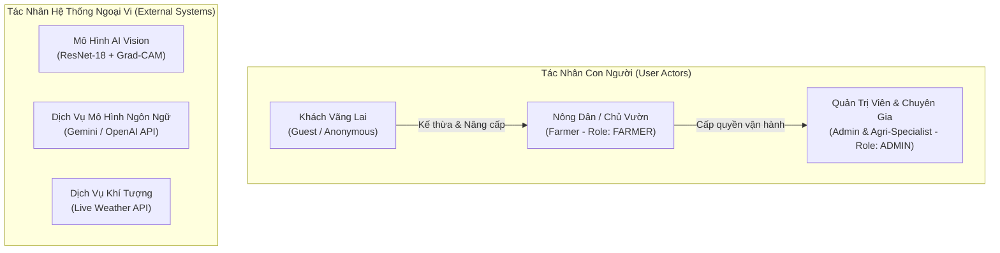
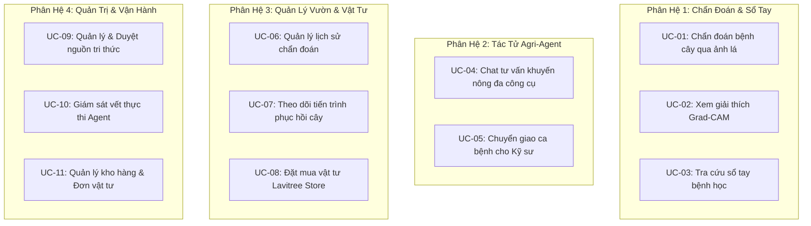
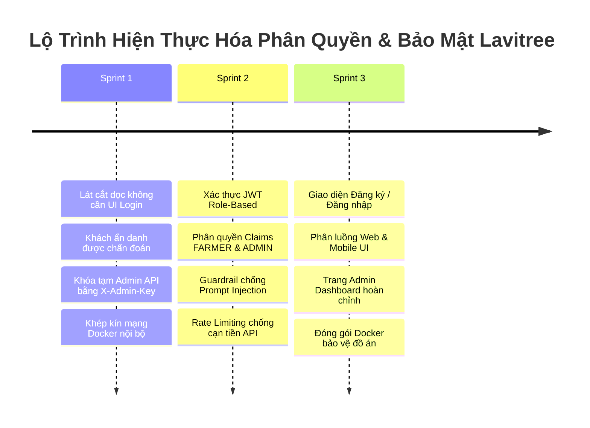

# 👥 ĐẶC TẢ TÁC NHÂN, MA TRẬN PHÂN QUYỀN & CA SỬ DỤNG (ROLES-USECASES.MD)
## Hệ thống Lavitree — Chuẩn Phân Tích & Thiết Kế Đồ Án Tốt Nghiệp PTIT

> **Mục đích tài liệu**: Định nghĩa tường minh các Tác nhân (Actors), Ma trận phân quyền (RBAC Matrix), Danh mục Ca sử dụng (Use Cases) và Lộ trình xác thực của hệ thống Lavitree. Tài liệu này đóng vai trò căn cứ thiết kế cho mã nguồn hệ thống và cung cấp nội dung chuẩn cho **Chương 2 (Phân tích yêu cầu hệ thống)** của quyển Báo cáo Tốt nghiệp PTIT.

---

## 1. DANH SÁCH TÁC NHÂN HỆ THỐNG (SYSTEM ACTORS)

Hệ thống Lavitree phục vụ 3 nhóm người dùng chính và 3 tác nhân hệ thống ngoại vi:

### 1.1. Tác nhân Con người (Human Actors)

#### 🧑‍🌾 1. Khách Vãng Lai (Guest / Anonymous User)
- **Mô tả**: Người dùng truy cập hệ thống qua Web hoặc Mobile App mà chưa đăng ký hoặc chưa đăng nhập tài khoản.
- **Mục tiêu**: Trải nghiệm thử tính năng chẩn đoán lá, xem vùng bệnh nhiệt Grad-CAM, tra cứu sổ tay bệnh học và tìm hiểu phương pháp điều trị trước khi ra quyết định tạo tài khoản.
- **Đặc điểm kỹ thuật**: Hệ thống xử lý request với `UserId = null` trên CSDL. Dữ liệu chẩn đoán chỉ lưu tạm thời ở phiên làm việc (Session/LocalStorage).
- **Phạm vi quyền**:
  - Chụp ảnh và chẩn đoán bệnh lá tức thì kèm bản đồ nhiệt Grad-CAM.
  - Xem quy trình Quản lý dịch hại tổng hợp (IPM) và các biện pháp canh tác cơ bản.
  - Tra cứu Sổ tay 14 loài cây và 40 lớp bệnh học (38 lớp mô hình AI + 2 lớp bổ trợ).
  - Trò chuyện thử nghiệm với Agri-Agent (bị giới hạn nghiêm ngặt 3–5 lượt hỏi/ngày theo IP để bảo vệ ngân sách API).
  - ❌ *Không có quyền*: Lưu trữ lịch sử dài hạn, theo dõi phục hồi sau điều trị, đặt mua vật tư trên Lavitree Store, truy cập chức năng quản trị.

#### 👨‍🌾 2. Nông Dân / Chủ Vườn (Farmer / Authenticated User - Role: `FARMER`)
- **Mô tả**: Người dùng đã hoàn tất đăng ký tài khoản cá nhân và đăng nhập vào hệ thống.
- **Mục tiêu**: Quản lý sức khỏe vườn cây lâu dài, theo dõi tiến trình hồi phục của cây sau khi phun thuốc, nhận tư vấn khuyến nông sâu sát từ Agri-Agent, đặt mua vật tư nông nghiệp chính hãng và kết nối với chuyên gia khi gặp ca bệnh khó.
- **Phạm vi quyền**:
  - **Kế thừa toàn bộ quyền của Khách Vãng Lai**.
  - Lưu trữ và đồng bộ hóa toàn bộ lịch sử chẩn đoán cây trồng gắn liền với tài khoản cá nhân.
  - Sử dụng tính năng **Nhật ký theo dõi phục hồi**: Chụp lại lá sau 3–5 ngày để AI đối soát mức độ khỏi bệnh (Day 1 vs Day 4).
  - Lập lịch chăm sóc định kỳ cho cây khỏe mạnh (`___healthy`) theo ngày tuổi của cây.
  - Tương tác không giới hạn (hoặc hạn mức cao) với Agri-Agent.
  - Xác nhận đơn thuốc khuyến nghị và đặt mua vật tư trực tiếp từ Lavitree Store (thanh toán COD hoặc VietQR).
  - Yêu cầu chuyển giao ca bệnh (Escalation) sang Kỹ sư Nông nghiệp Lavitree khi điểm tin cậy thấp hoặc nghi ngờ bệnh lạ.

#### 👨‍⚕️ 3. Quản Trị Viên & Kỹ Sư Nông Nghiệp (Admin & Agricultural Specialist - Role: `ADMIN`)
- **Mô tả**: Nhóm chuyên môn phụ trách vận hành kỹ thuật, kiểm duyệt tri thức nông học, quản trị kho hàng và tiếp nhận xử lý các ca bệnh dã ngoại phức tạp.
- **Quyết định thiết kế**: Để tinh gọn bộ máy và tối ưu hóa thời gian thực hiện đồ án cho nhóm 2 người, hệ thống gộp vai trò *Kỹ sư Nông nghiệp* vào vai trò *Quản trị viên* (sử dụng chung vai trò `ADMIN` trong bảng `Users`).
- **Phạm vi quyền**:
  - Quản lý danh mục người dùng, phân quyền và khóa tài khoản vi phạm.
  - Cổng Quản trị Tri thức (Knowledge Management): Thêm mới, chỉnh sửa, phê duyệt và cập nhật danh mục 112 tài liệu khuyến nông, đơn thuốc BVTV và thời gian cách ly (PHI).
  - Cổng Quản lý Kho vật tư Lavitree Store: Cập nhật thuốc, tồn kho theo chi nhánh (Hà Nội, Lâm Đồng, Cần Thơ), giá niêm yết và trạng thái đơn hàng.
  - Màn hình Giám sát Vết thực thi (Agent Observability Waterfall Chart): Theo dõi trực tiếp chu trình ReAct, latency từng bước, token tiêu thụ và xuất file `trace_waterfall.json`.
  - Tiếp nhận và phản hồi trực tiếp các ca bệnh chuyển giao (Human-in-the-loop Escalation) trong cùng một khung chat với nông dân.

### 1.2. Tác nhân Hệ thống Ngoại Vi (External System Actors)

1. **AI Vision Service (`backend/ai-service`)**: Microservice FastAPI chạy mô hình ResNet-18 và trích xuất bản đồ nhiệt Grad-CAM, thực thi bộ lọc OOD đa tầng.
2. **LLM Provider (Google Gemini / OpenAI)**: Cung cấp năng lực suy luận ngôn ngữ, tư duy ReAct cho `backend/agent-service`.
3. **Live Weather Service API**: Cung cấp dữ liệu nhiệt độ, độ ẩm và dự báo mưa phục vụ công cụ `check_weather_risk` của Agent.

---

## 2. MA TRẬN PHÂN QUYỀN CHỨC NĂNG (RBAC PERMISSION MATRIX)

Bảng phân quyền chi tiết cho toàn bộ các tính năng của hệ thống Lavitree:

| Phân Hệ | Chức Năng Cụ Thể | Khách Vãng Lai | Nông Dân (`FARMER`) | Quản Trị & Kỹ Sư (`ADMIN`) | Ghi Chú Kỹ Thuật |
|---|---|:---:|:---:|:---:|---|
| **Chẩn Đoán & AI Vision** | Chụp/Tải ảnh lá & Nhận kết quả | ✅ | ✅ | ✅ | Lưu MinIO, `UserId` có thể null |
| | Xem bản đồ nhiệt Grad-CAM | ✅ | ✅ | ✅ | Overlay Jet trên lớp `layer4[-1]` |
| | Nhận diện OOD & Cảnh báo bất định | ✅ | ✅ | ✅ | Tự động gắn cờ `is_ood` / `is_uncertain` / lớp dễ nhầm |
| | Xem hướng dẫn xử lý chuẩn IPM | ✅ | ✅ | ✅ | Trích xuất từ PostgreSQL |
| **Sổ Tay Bệnh Cây** | Tra cứu 14 loài cây & 40 lớp bệnh | ✅ | ✅ | ✅ | Hỗ trợ tìm kiếm & lọc Offline |
| | Xem chi tiết triệu chứng & nguồn trích dẫn | ✅ | ✅ | ✅ | Hiển thị link gốc bài báo khoa học |
| **Lịch Sử & Vườn Cây** | Lưu trữ lịch sử chẩn đoán | ❌ | ✅ | ✅ | Khách chỉ lưu tạm Session |
| | Theo dõi tiến trình hồi phục (Day 1 vs 4) | ❌ | ✅ | ✅ | So sánh tiến triển đốm bệnh |
| | Lập kế hoạch chăm sóc cây khỏe | ❌ | ✅ | ✅ | Nhắc lịch tưới, bón phân theo tuổi |
| **Trợ Lý Agri-Agent** | Trò chuyện tư vấn nông nghiệp (ReAct) | ✅ *(Giới hạn 3-5 lượt)* | ✅ *(Không giới hạn)* | ✅ | Rate limit theo IP đối với Khách |
| | Kê đơn thuốc nháp `[DRAFT_RECOMMENDATION]` | ❌ | ✅ | ✅ | Chỉ tạo đơn khi có xác nhận |
| | Rào chắn an toàn (PHI, chống độc hại) | ✅ | ✅ | ✅ | Kiểm tra bắt buộc trong code Tool |
| | Yêu cầu chuyển ca cho Kỹ sư con người | ❌ | ✅ | ❌ | Gửi thông báo đến Dashboard Admin |
| **Vật Tư Lavitree Store** | Xem danh mục vật tư & giá niêm yết | ✅ | ✅ | ✅ | Công khai danh mục thuốc hợp pháp |
| | Đặt mua vật tư điều trị bệnh | ❌ | ✅ | ❌ | Sinh đơn hàng trong bảng `Orders` |
| | Tra cứu trạng thái đơn hàng của mình | ❌ | ✅ | ❌ | Theo dõi qua mã đơn |
| **Quản Trị & Giám Sát** | Thêm, sửa, xóa nguồn tri thức (112 bài) | ❌ | ❌ | ✅ | Yêu cầu Admin API Key / JWT |
| | Quản lý kho thuốc, giá và đơn hàng | ❌ | ❌ | ✅ | Cập nhật kho Hà Nội, Cần Thơ... |
| | Trả lời ca bệnh chuyển giao (Human Support)| ❌ | ❌ | ✅ | Nhắn trực tiếp vào chat nông dân |
| | Xem Waterfall Trace & Đo đạc Agent | ❌ | ❌ | ✅ | Xuất file `trace_waterfall.json` |
| | Quản lý tài khoản người dùng | ❌ | ❌ | ✅ | Xem danh sách, kích hoạt, khóa |

---

## 3. DANH MỤC CA SỬ DỤNG (USE CASE CATALOG)

Hệ thống được tổ chức thành 4 phân hệ ca sử dụng chính:

### 3.1. Đặc tả Chi tiết các Ca sử dụng Cốt lõi (Core Use Case Specifications)

#### 📝 UC-01: Chẩn đoán bệnh cây qua ảnh lá (Lát cắt dọc Sprint 1)
- **Mã ca sử dụng**: `UC-01`
- **Tác nhân chính**: Khách vãng lai, Nông dân.
- **Tác nhân hỗ trợ**: Core API (.NET 8), AI Vision Service (FastAPI + ResNet-18), MinIO Storage, PostgreSQL.
- **Điều kiện tiên quyết (Pre-condition)**: Người dùng có thiết bị chụp ảnh hoặc tệp ảnh lá cây (định dạng JPG/PNG/WebP, dung lượng $\le 10$MB).
- **Luồng sự kiện chính (Main Success Scenario)**:
  1. Người dùng chọn ảnh hoặc chụp ảnh lá cây từ camera và bấm nút *"Chẩn đoán"*.
  2. Client gửi yêu cầu `POST /api/v1/diagnose` kèm tệp ảnh đến Core API.
  3. Core API kiểm tra dung lượng ảnh ($\le 10$MB), đẩy ảnh gốc vào MinIO bucket `lavitree-diagnoses`.
  4. Core API chuyển tiếp ảnh sang AI Vision Service qua endpoint nội bộ `POST /api/v1/predict?include_heatmap=true`.
  5. AI Service thực thi:
     - Kiểm tra tính hợp lệ của ảnh qua Pillow (chống Decompression Bomb).
     - Chạy bộ lọc OOD đa tầng (`ood_filter.py`): Đánh giá màu sắc và Energy Score trên logits.
     - Suy luận mô hình ResNet-18, trích xuất lớp `layer4[-1]` sinh bản đồ nhiệt Grad-CAM.
     - Trả về Top-1, Top-3, cờ `is_ood`, `is_uncertain`, `confusion_group` và chuỗi base64 ảnh Grad-CAM.
  6. Core API nhận kết quả, lưu ảnh Grad-CAM vào MinIO, truy vấn CSDL PostgreSQL lấy hướng dẫn Quản lý dịch hại tổng hợp (IPM) và thuốc điều trị được cấp phép.
  7. Core API lưu bản ghi vào bảng `DiagnosisRecords` (với `UserId` nếu đã đăng nhập).
  8. Hệ thống trả về kết quả đầy đủ cho Client hiển thị lên màn hình.
- **Luồng rẽ nhánh / Ngoại lệ (Extensions / Exception Flows)**:
  - *4a. Ảnh ngoại lai không có lá cây (bàn tay, mặt bàn, đồ vật)*: Bộ lọc OOD phát hiện `is_ood = true`. Hệ thống dừng chẩn đoán, trả về thông báo lỗi: *"Ảnh nằm ngoài phạm vi cây trồng được hỗ trợ. Vui lòng căn chỉnh lại lá cây."*
  - *4b. Ảnh bị mờ hoặc độ tin cậy $< 70\%$*: Hệ thống hiển thị kết quả kèm viền vàng cảnh báo bất định và gợi ý chụp lại góc sáng rõ hơn.
- **Điều kiện sau (Post-condition)**: Bản ghi chẩn đoán được lưu trữ, ảnh hiển thị trực quan cho người dùng.

---

#### 📝 UC-04: Chat tư vấn khuyến nông đa công cụ với Agri-Agent (Sprint 2)
- **Mã ca sử dụng**: `UC-04`
- **Tác nhân chính**: Nông dân (toàn quyền), Khách vãng lai (tối đa 3–5 câu/ngày).
- **Tác nhân hỗ trợ**: Agent Service (FastAPI + MCP Tools), Live Weather API, Core API, Gemini LLM.
- **Điều kiện tiên quyết**: Đã có kết quả chẩn đoán bệnh từ UC-01 hoặc người dùng nhập câu hỏi nông nghiệp.
- **Luồng sự kiện chính**:
  1. Người dùng bấm nút *"Hỏi thêm Trợ lý AI"* hoặc gõ câu hỏi vào khung chat.
  2. Client thiết lập kết nối Server-Sent Events (SSE) đến `POST /api/v1/agent/chat`.
  3. Agent Service khởi chạy chu trình suy luận ReAct (`Thought → Action → Observation`):
     - Phân tích ngữ cảnh câu hỏi và lịch sử khám lá.
     - Lựa chọn gọi công cụ thích hợp: tra cứu tri thức chuyên sâu (`lookup_disease_knowledge`), kiểm tra thời tiết xem có sắp mưa không (`check_weather_risk`), hoặc kiểm tra thời gian cách ly PHI (`verify_phi_safety`).
  4. Bộ Chốt chặn an toàn (Guardrail) trong code công cụ thẩm định:
     - Nếu ngày dự kiến thu hoạch $\le 3$ ngày: Từ chối gợi ý thuốc hóa học, ép chuyển sang chế phẩm sinh học.
  5. Agent tổng hợp câu trả lời, gắn nhãn đề xuất vật tư `[DRAFT_RECOMMENDATION]`, truyền phát (stream) từng dòng text về Client qua SSE.
  6. Toàn bộ tiến trình suy luận và độ trễ được ghi vết vào bộ nhớ quan sát (Observability Trace).
- **Luồng ngoại lệ**:
  - *3a. Người dùng hỏi chủ đề ngoài lề (chính trị, giải trí)*: Guardrail chặn câu hỏi, lịch sự nhắc nhở: *"Tôi là Trợ lý Nông nghiệp Lavitree, chỉ hỗ trợ các vấn đề chăm sóc cây trồng."*
  - *3b. Mất kết nối mạng Internet*: Router Circuit Breaker hạ cấp tự động, trích xuất dữ liệu tĩnh từ bảng `TreatmentPlans` trả về cho người dùng.

---

#### 📝 UC-09: Quản lý & Thẩm định Tri thức Khuyến nông (Admin Portal)
- **Mã ca sử dụng**: `UC-09`
- **Tác nhân chính**: Quản trị viên & Kỹ sư Nông nghiệp (`ADMIN`).
- **Tác nhân hỗ trợ**: Core API (.NET 8), PostgreSQL Supabase.
- **Điều kiện tiên quyết**: Yêu cầu xác thực quyền Admin (Sprint 1: Header `X-Admin-Key`; Sprint 2-3: JWT Token Role `ADMIN`).
- **Luồng sự kiện chính**:
  1. Admin truy cập Cổng quản trị tri thức.
  2. Hệ thống tải danh mục 112 bài báo khoa học và các phác đồ IPM từ CSDL.
  3. Admin thực hiện các thao tác:
     - Xem chi tiết nguồn tài liệu, đối chiếu tên miền chính thống (`.gov.vn`, `.edu`).
     - Thêm nguồn tài liệu mới cho các lớp bệnh.
     - Chỉnh sửa thông tin hoạt chất, nồng độ pha bình và thời gian cách ly (PHI) theo Thông tư mới nhất của Bộ NN&PTNT.
     - Xuất dữ liệu tri thức ra tệp CSV để kiểm toán dữ liệu.
  4. Core API kiểm tra quyền xác thực, cập nhật dữ liệu an toàn vào CSDL Supabase và ghi log hành động.
- **Luồng ngoại lệ**:
  - *4a. Yêu cầu thiếu Header xác thực hoặc sai Key/Token*: Hệ thống từ chối với mã lỗi `401 Unauthorized` hoặc `403 Forbidden`, ngăn chặn mọi hành vi xâm phạm kho tri thức.

---

## 4. LỘ TRÌNH TRIỂN KHAI XÁC THỰC (AUTHENTICATION ROADMAP)

Để đảm bảo tiến độ dự án theo phương pháp Agile, hệ thống triển khai bảo mật theo lộ trình 3 giai đoạn:

### Chi tiết từng giai đoạn:
1. **Sprint 1 (Khởi tạo Nền tảng Core)**:
   - Mục tiêu tối thượng là thông luồng chụp ảnh $\rightarrow$ chẩn đoán $\rightarrow$ trả kết quả.
   - Chưa xây dựng màn hình Đăng ký/Đăng nhập để tránh lãng phí thời gian.
   - Các API nhạy cảm của Admin (`POST/DELETE /api/v1/knowledge/sources`) được bảo vệ bằng cơ chế **Tạm thời qua Header `X-Admin-Key`**:
     - Client / Postman gửi kèm `X-Admin-Key: <ADMIN_SECRET_KEY>`.
     - Key được lưu trong `.env`, không commit lên GitHub.
   - Các cổng nhạy cảm của AI Service (8000), Agent (8001) và MinIO Console (9001) được đóng lại trong `docker-compose.yml`, chỉ cho phép giao tiếp nội bộ qua mạng Docker.
2. **Sprint 2 (Bảo mật Tác tử & Xác thực JWT)**:
   - Hiện thực hóa Identity / JWT Authentication trong Core API.
   - Tạo sẵn tài khoản Admin đầu tiên thông qua script Seeder an toàn.
   - Triển khai Rate Limiting trên API Chat để ngăn chặn tấn công từ chối ví tiền (Denial of Wallet).
   - Đặt bộ chốt chặn PHI và quyền hạn trong mã nguồn Tool của Agent.
3. **Sprint 3 (Trải nghiệm Người dùng & Đóng gói)**:
   - Hoàn thiện giao diện Web Portal (React Vite) và Mobile App (Jetpack Compose) có màn hình Đăng ký / Đăng nhập.
   - Tích hợp Guards bảo vệ router trên giao diện Web (chỉ Admin mới vào được `/admin`).
   - Đóng gói container Docker phục vụ buổi bảo vệ đồ án.
