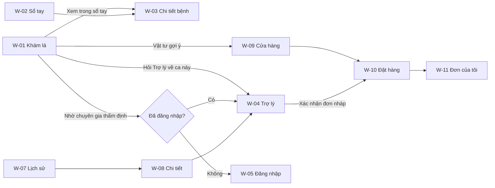

# 🧭 DANH MỤC MÀN HÌNH & ĐIỀU HƯỚNG (SCREENS.MD)
## Hệ thống Lavitree — Web Portal & Android App
*Tài liệu nghiệp vụ: màn hình nào, ai được vào, đi từ đâu tới đâu. Không mô tả màu sắc / công nghệ — phần đó ở [docs/architecture/ui-ux.md](../architecture/ui-ux.md).*
*Căn cứ: [roles-usecases.md](roles-usecases.md) (RBAC & UC), [features.md](features.md), [classes.md](classes.md) mục 3–4.*

---

## 1. DANH MỤC MÀN HÌNH WEB

| Mã | Màn hình | Route | Quyền | Use Case | Sprint / Task |
|---|---|---|---|---|---|
| W-01 | Khám lá (tải ảnh + kết quả) | `/` | Guest, FARMER, ADMIN | UC-01, UC-02 | S2 · A02 |
| W-02 | Sổ tay bệnh học (danh sách + lọc) | `/handbook` | Tất cả | UC-03 | S2 · A02 |
| W-03 | Chi tiết bệnh trong sổ tay | `/handbook/:classCode` | Tất cả | UC-03 | S2 · A02 |
| W-04 | Trợ lý cây trồng (Chat) | `/chat` | Tất cả (Guest giới hạn lượt) | UC-04, UC-05 | S2 · A04 |
| W-05 | Đăng nhập | `/login` | Chỉ Guest | — | S2 · A02 |
| W-06 | Đăng ký | `/register` | Chỉ Guest | — | S2 · A02 |
| W-07 | Lịch sử chẩn đoán | `/history` | FARMER, ADMIN | UC-06 | S2 · A02 |
| W-08 | Chi tiết một lần chẩn đoán | `/history/:id` | Chủ sở hữu, ADMIN | UC-06 | S2 · A02 |
| W-09 | Cửa hàng vật tư | `/store` | Tất cả (chỉ xem) | UC-08 | S2 · A03 |
| W-10 | Giỏ hàng & Đặt hàng (COD) | `/checkout` | FARMER | UC-08 | S2 · A03 |
| W-11 | Đơn hàng của tôi | `/orders` | FARMER | UC-08 | S2 · A03 |
| W-12 | Theo dõi phục hồi (Ngày 1 vs Ngày 4) | `/history/:id/recovery` | FARMER | UC-07 | S3 (cắt nếu thiếu thời gian) |
| A-01 | Tổng quan Admin | `/admin` | ADMIN | — | S2 · A03 |
| A-02 | Quản trị & duyệt tri thức | `/admin/knowledge` | ADMIN | UC-09 | S2 · A03 |
| A-03 | Ca cần chuyên gia (`requires_expert`) | `/admin/escalations` | ADMIN | UC-05 | S2 · A03 |
| A-04 | Kho thuốc & giá | `/admin/inventory` | ADMIN | UC-11 | S2 · A03 |
| A-05 | Quản lý đơn hàng | `/admin/orders` | ADMIN | UC-11 | S3 |
| A-06 | Waterfall Trace của Agent | `/admin/traces`, `/admin/traces/:traceId` | ADMIN | UC-10 | S3 · TASK-11 |
| A-07 | Quản lý người dùng | `/admin/users` | ADMIN | — | S3 |
| X-01 | 404 / 403 | `*` | Tất cả | — | S2 · A00 |

> `KnowledgeCollectorPage.tsx` hiện tại là bản demo; logic gọi API được giữ lại, giao diện viết lại thành **A-02** trong khung Admin.

---

## 2. MÀN HÌNH ANDROID

| Mã | Màn hình | Sprint | Ghi chú |
|---|---|---|---|
| M-01 | Trang chủ | S2 · A04 | Nút lớn "Khám lá" + lối tắt Sổ tay / Trợ lý |
| M-02 | Chụp ảnh (CameraX + khung ngắm 15–20cm) | S2 · A04 | FEAT-01: cảnh báo ảnh tối / rung mờ trước khi gửi |
| M-03 | Kết quả chẩn đoán | S2 · A04 | Cùng quy tắc với W-01 (mục 4) |
| M-04 | Trợ lý (Chat SSE) | S2 khung · S3 nối thật | Cùng quy tắc với W-04 |
| M-05 | Lịch sử · Sổ tay · Tài khoản | S3 · TASK-10 | — |

Android không có màn hình Admin.

---

## 3. ĐIỀU HƯỚNG

- **Thanh điều hướng người dùng** (5 mục, cố định thứ tự): Khám lá · Sổ tay · Trợ lý · Cửa hàng · Tài khoản.
  - Màn hình rộng: thanh ngang trên cùng. Màn hình hẹp (< 768px): thanh tab dưới đáy, giống app.
  - "Tài khoản" khi chưa đăng nhập → W-05; khi đã đăng nhập → menu (Lịch sử, Đơn hàng, Đăng xuất; ADMIN thấy thêm "Quản trị").
- **Khung Admin**: thanh bên trái (Tổng quan · Tri thức · Ca chuyên gia · Kho thuốc · Đơn hàng · Trace · Người dùng) + nút "Về trang người dùng".

---

## 4. QUY TẮC NGHIỆP VỤ TRÊN MÀN HÌNH KẾT QUẢ (W-01, W-08, M-03)

Thứ tự khối từ trên xuống — **không được đảo**:

1. **Câu miễn trừ cố định**: *"Kết quả là gợi ý tham khảo, không thay thế chẩn đoán của chuyên gia."*
2. **Nhãn trạng thái + `warning_message`** — theo [classes.md mục 4](classes.md):

| Trạng thái | Điều kiện | Hiển thị |
|---|---|---|
| 🟢 Kết quả tham khảo | `is_uncertain = false`, không thuộc `confusion_group` | Top-1; Top-3 thu gọn ("Xem khả năng khác") |
| 🟡 Dễ nhầm – xem thêm khả năng khác | `is_uncertain = false`, có `confusion_group` | Top-3 mở sẵn |
| 🔴 Chưa chắc chắn – nên chụp lại | `is_uncertain = true` | Top-3 mở sẵn + nút "Chụp lại" + "Nhờ chuyên gia thẩm định" |
| ⚪ Không nhận diện được lá cây | `is_ood = true` | **Chỉ** cảnh báo + nút "Chụp lại". Không tên bệnh, không Grad-CAM, không hướng dẫn, không vật tư |

3. **Tên bệnh Top-1** + tên cây + `severity_level` + độ tin cậy của mô hình (dạng %). Cấm dùng chữ "Độ tin cậy cao".
4. **Ảnh gốc ↔ Grad-CAM** (so sánh bằng thanh trượt) + chú giải *"Vùng màu đỏ là nơi mô hình chú ý nhiều nhất, không phải ranh giới chính xác của vết bệnh."*
5. **Hướng dẫn xử lý IPM**: hiển thị **đúng số bước** API trả về trong `treatment_guidelines` (không cố định số bước). Bước có `isolation_days` hiện nhãn "Cách ly N ngày".
6. **Vật tư gợi ý** (`recommended_products`):
   - 🟢/🟡: hiển thị bình thường.
   - 🔴: thu gọn sau dòng *"Chỉ tham khảo sau khi chuyên gia xác nhận bệnh"* — tránh đẩy người dùng mua thuốc khi mô hình chưa chắc.
   - Danh sách rỗng (ví dụ lớp `___healthy`): ẩn cả khối.
7. **Nguồn kiểm chứng** (`verified_sources`): tên tổ chức + tiêu đề + link mở tab mới.
8. **Hành động**: "Hỏi Trợ lý về ca này" (mang theo `class_code` sang W-04) · "Khám ảnh khác".

**Guest**: kết quả chỉ lưu trong phiên trình duyệt; dưới kết quả hiện gợi ý *"Đăng nhập để lưu lịch sử"*.

---

## 5. QUY TẮC TRÊN MÀN HÌNH TRỢ LÝ (W-04, M-04)
- Ô nhập câu hỏi + 3 trường ngữ cảnh tùy chọn: **Địa điểm**, **Số ngày đến thu hoạch**, **Bệnh đang gặp** (tự điền khi đi từ W-01/W-08).
- Quá trình suy luận (gọi công cụ) hiển thị dạng thu gọn được; câu trả lời hiện dần theo từng chữ.
- Khi Agent chặn thuốc vì thời gian cách ly (PHI) → khối cảnh báo đỏ nằm **trên** câu trả lời.
- Đơn thuốc nháp `[DRAFT_RECOMMENDATION]` → thẻ "Đơn nháp – cần bạn xác nhận". **Chỉ tạo đơn khi người dùng bấm xác nhận** (Human-in-the-loop). Guest thấy thẻ nhưng nút dẫn tới W-05.
- Guest hết lượt hỏi trong ngày → thông báo rõ số lượt + gợi ý đăng nhập; không hiện lỗi kỹ thuật.

---

## 6. QUY TẮC CHUYỂN HƯỚNG & PHÂN QUYỀN GIAO DIỆN
- Guest vào trang cần đăng nhập → W-05 kèm `?next=<trang cũ>`; đăng nhập xong quay lại đúng trang.
- FARMER vào `/admin/*` → trang 403. Đã đăng nhập mà vào `/login` → về `/`.
- ⚠️ Ẩn/hiện nút trên giao diện **chỉ để tiện dùng, không phải bảo mật**. Mọi kiểm tra quyền bắt buộc thực hiện ở Core API (TASK-A01).
