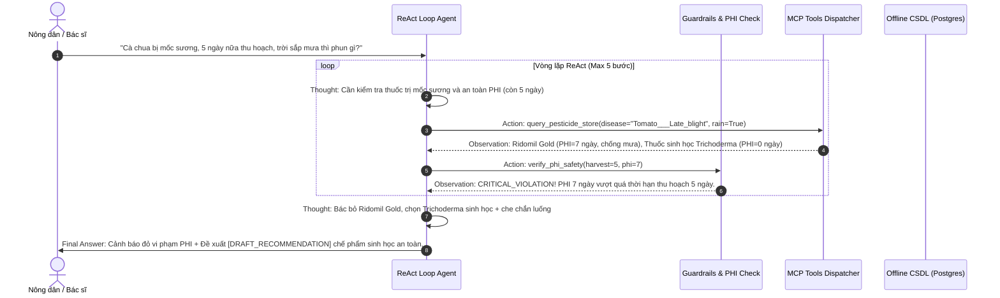

# TASK-07: CHU TRÌNH REACT LOOP, BỘ CHỐT CHẶN AN TOÀN (GUARDRAILS) & ROUTER HẠ CẤP
* **Sprint**: Sprint 2 (Trí tuệ Nhân tạo Tác tử & Hệ sinh thái MCP)
* **Phân hệ**: `backend/agent-service/app/agent/`
* **Trạng thái**: `[ ] PENDING`
* **Người phụ trách**: Thành viên B (Agent Core & AI Safety)
* **Độ ưu tiên**: P0 - Bắt buộc cốt lõi
* **Kế thừa từ nguyên mẫu**: `extract/DAY3/lavitree_react_agent.py`, `extract/DAY25/lavitree_reliability_resilience.py`, `extract/DAY27/lavitree_hitl_orchestration.py`

---

## 1. BỐI CẢNH & MỤC TIÊU (CONTEXT & OBJECTIVES)
- **Mô tả ngắn**: Xây dựng bộ não suy luận trung tâm của Agent theo chu trình **ReAct Loop** (`Thought → Action → Observation → Final Answer`). Agent tiếp nhận chẩn đoán từ Vision Service hoặc câu hỏi trực tiếp từ nông dân, tự động lập luận và gọi các công cụ MCP phù hợp để đưa ra giải pháp điều trị toàn diện.
- **3 Chốt chặn An toàn (Boundary Guardrails)**:
  1. **Chốt chặn lặp vô tận**: Khống chế `max_iterations = 5`. Nếu sau 5 bước chưa kết luận, Agent buộc phải dừng lại và tổng hợp thông tin hiện có.
  2. **Chốt chặn PHI (Bảo vệ tính mạng & an toàn thực phẩm)**: Nếu nông dân thông báo thời gian đến kỳ thu hoạch $\le$ thời gian cách ly của thuốc bảo vệ thực vật ($DaysToHarvest \le PHI$), Agent lập tức **kích hoạt báo động đỏ**: từ chối mọi loại thuốc hóa học có thời gian cách ly dài và bắt buộc chuyển hướng sang biện pháp sinh học/canh tác.
  3. **Chốt chặn HITL (Human-in-the-loop - Khớp mô hình Bác sĩ Cây trồng Lavitree)**: Mọi đơn thuốc đề xuất phải gắn tiền tố `[DRAFT_RECOMMENDATION]` để thể hiện tính chất gợi ý chuyên môn, yêu cầu Bác sĩ phụ trách hoặc Nông dân chủ động bấm nút xác nhận tạo đơn mua hàng.
- **Cơ chế Tự phục hồi & Hạ cấp Ngoại tuyến (Resilience - DAY25, 27)**:
  - Bọc **Circuit Breaker** quanh các lời gọi LLM Cloud và Live Weather API.
  - Khi phát hiện rớt mạng ngoài đồng ruộng, LLM bị lỗi hoặc hết quota: Router tự động chuyển sang chế độ **Graceful Degradation** — truy vấn phác đồ tĩnh IPM từ CSDL Supabase/PostgreSQL cục bộ đã seed ở Sprint 1 để trả lời ngay lập tức, đảm bảo ứng dụng không bao giờ bị treo hoặc sập.

---

## 2. ĐẶC TẢ KỸ THUẬT (SPECIFICATIONS)

### Luồng Hoạt Động của ReAct Agent:

---

## 3. KẾ HOẠCH BẺ NHỎ THỰC THI (COOKING PHASES)
- [ ] **Pha 1**: Chuyển mã nguồn `extract/DAY3/lavitree_react_agent.py` vào `backend/agent-service/app/agent/react_agent.py`.
- [ ] **Pha 2**: Tích hợp client gọi mô hình ngôn ngữ (Google Gemini 1.5 Flash / OpenAI GPT-4o-mini) với prompt hệ thống nghiêm ngặt từ `DAY4/prompt.md`.
- [ ] **Pha 3**: Triển khai module `guardrails.py` kiểm định các điều kiện biên:
  - Hàm `sanitize_action`: Chống lỗi Format Drift JSON do LLM sinh ra.
  - Hàm `enforce_phi_boundary`: Bắt buộc kích hoạt cờ đỏ khi vi phạm cách ly.
  - Hàm `enforce_hitl_tag`: Tự động gắn tag `[DRAFT_RECOMMENDATION]`.
- [ ] **Pha 4**: Triển khai `resilience.py` (kế thừa `extract/DAY25/lavitree_reliability_resilience.py`):
  - Circuit Breaker với 3 trạng thái: `CLOSED`, `OPEN`, `HALF-OPEN`.
  - Router chuyển chế độ tự động fallback về CSDL cục bộ khi circuit breaker mở (`OPEN`).
- [ ] **Pha 5**: Viết script kiểm thử `test_react_guardrails.py` kiểm chứng ca thử nghiệm lâm sàng vi phạm PHI và ca thử nghiệm ngắt mạng.

---

## 4. TIÊU CHÍ NGHIỆM THU & BẰNG CHỨNG (ACCEPTANCE CRITERIA & RECEIPTS)
- [ ] Chu trình ReAct Loop thực thi đúng format `Thought → Action → Observation → Final Answer`.
- [ ] Số vòng lặp không vượt quá 5 bước trong mọi trường hợp.
- [ ] 100% ca thử nghiệm thời gian thu hoạch $\le$ PHI kích hoạt thành công cảnh báo đỏ và chuyển sang phác đồ sinh học an toàn.
- [ ] Khi ngắt kết nối mạng internet hoặc tắt API Key LLM, hệ thống tự động kích hoạt Router hạ cấp, trả về phác đồ tĩnh IPM từ CSDL với mã HTTP 200 trong $< 1.0$ giây.
- [ ] Bằng chứng nghiệm thu: Log chạy `test_react_guardrails.py` pass 100% kịch bản.
