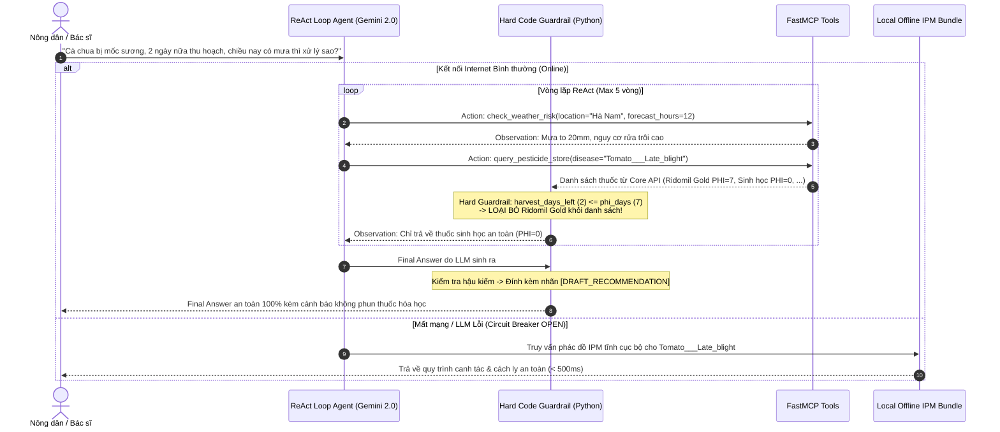

# TASK-07: CHU TRÌNH REACT LOOP, BỘ CHỐT CHẶN AN TOÀN (HARD GUARDRAILS) & ROUTER HẠ CẤP NGOẠI TUYẾN
* **Sprint**: Sprint 2 (Trí tuệ Nhân tạo Tác tử & Hệ sinh thái MCP)
* **Thứ tự thực hiện trong Sprint**: **Ưu tiên số 3 (Triển khai sau khi Task 06 và Task 05 đã hoàn thành)**
* **Phân hệ**: `backend/agent-service/app/agent/`
* **Trạng thái**: `[ ] PENDING`
* **Người phụ trách**: Thành viên B (Agent Core & AI Safety)
* **Độ ưu tiên**: P0 - Bắt buộc cốt lõi
* **Kế thừa từ nguyên mẫu**: `extract/DAY3/lavitree_react_agent.py`, `extract/DAY25/lavitree_reliability_resilience.py`, `extract/DAY27/lavitree_hitl_orchestration.py`

---

## 1. BỐI CẢNH & MỤC TIÊU (CONTEXT & OBJECTIVES)
- **Mô tả ngắn**: Xây dựng bộ não suy luận trung tâm của Agent theo chu trình **ReAct Loop** (`Thought → Action → Observation → Final Answer`) sử dụng mô hình **Google Gemini 2.0 / 2.5 Flash** (thay thế Gemini 1.5 Flash đã deprecated). Agent tiếp nhận chẩn đoán từ Vision Service hoặc câu hỏi trực tiếp từ nông dân, tự động lập luận và gọi các công cụ MCP phù hợp để đưa ra giải pháp điều trị toàn diện.
- **Bộ 3 Chốt chặn An toàn Cốt tử (Safety Guardrails)**:
  1. **Khống chế lặp vô hạn**: Giới hạn cứng `max_iterations = 5`. Nếu sau 5 vòng chưa kết luận, Agent buộc phải dừng lại và tổng hợp thông tin hiện có kèm cảnh báo cần tham vấn chuyên gia.
  2. **Chốt chặn an toàn bằng Code (Hard Guardrails - Không phụ thuộc LLM)**:
     - **Tiền lọc (Pre-filter)**: Khi Agent gọi `query_pesticide_store`, code Python tự động lọc bỏ các loại thuốc có `IsAllowed = false` và thuốc vi phạm thời gian cách ly bảo thủ ($DaysToHarvest \le PhiDays$). LLM chỉ được nhìn thấy danh sách các thuốc an toàn để đưa vào câu trả lời.
     - **Hậu kiểm (Post-filter)**: Trước khi xuất câu trả lời cuối cùng, module `guardrails.py` quét chuỗi văn bản của LLM; nếu phát hiện tên hoạt chất độc hại hoặc thuốc hóa học bị cấm khi sát ngày thu hoạch, hệ thống lập tức chèn cảnh báo đỏ `⛔ NGUY CƠ TỒN DƯ THUỐC BVTV` và chuyển hướng sang biện pháp sinh học/canh tác.
  3. **Chốt chặn HITL (Human-in-the-loop)**: Mọi đơn thuốc đề xuất bắt buộc phải gắn tiền tố `[DRAFT_RECOMMENDATION]` để thể hiện tính chất gợi ý chuyên môn, yêu cầu Bác sĩ phụ trách hoặc Nông dân chủ động bấm nút xác nhận trước khi tạo đơn hàng.
- **Cơ chế Tự phục hồi & Hạ cấp Ngoại tuyến Thật sự (Resilience - DAY25, 27)**:
  - Bọc **Circuit Breaker** (3 trạng thái: `CLOSED`, `OPEN`, `HALF-OPEN`) quanh các lời gọi LLM Cloud và Weather API.
  - Khi phát hiện rớt mạng ngoài đồng ruộng, LLM bị lỗi hoặc hết quota: Router tự động chuyển sang chế độ **Graceful Degradation** — truy vấn trực tiếp từ **tệp phác đồ tĩnh IPM lưu cục bộ (Local JSON Cache: `app/agent/offline_ipm_cache.json`)**, tuyệt đối **không gọi Supabase Cloud** khi ngoại tuyến. Thời gian trả lời tức thì $< 1.0$ giây.

---

## 2. ĐẶC TẢ KỸ THUẬT (SPECIFICATIONS)

### Luồng Hoạt Động của ReAct Agent & Chốt Chặn Code:

---

## 3. KẾ HOẠCH BẺ NHỎ THỰC THI (COOKING PHASES)

- [ ] **Pha 1**: Cấu hình Client gọi **Google Gemini 2.0 Flash** (`google-genai` SDK hoặc `google-generativeai`), đọc `GEMINI_API_KEY` từ `.env`.
- [ ] **Pha 2**: Chuyển mã nguồn `extract/DAY3/lavitree_react_agent.py` vào `backend/agent-service/app/agent/react_agent.py`, kết nối 4 công cụ từ `app.mcp.server`.
- [ ] **Pha 3**: Xây dựng module `guardrails.py` cài đặt Hard Code Guardrail:
  - `pre_filter_medicines(medicines, harvest_days_left)`: Lọc bỏ thuốc có `IsAllowed=False` hoặc `phi_days >= harvest_days_left`.
  - `post_filter_response(response_text, harvest_days_left)`: Quét từ khóa hoạt chất hóa học độc hại khi `harvest_days_left <= 3`.
  - `apply_hitl_tag(response_text)`: Đảm bảo nhãn `[DRAFT_RECOMMENDATION]` luôn hiện diện.
- [ ] **Pha 4**: Triển khai `resilience.py` (kế thừa `extract/DAY25`):
  - Circuit Breaker đếm lỗi liên tiếp (ngưỡng 3 lỗi $\rightarrow$ chuyển trạng thái `OPEN`).
  - Chuẩn bị tệp `offline_ipm_cache.json` chứa phác đồ IPM chuẩn cho 5 bệnh demo.
  - Router tự động chuyển sang đọc file cache cục bộ khi Circuit Breaker `OPEN` hoặc khi bắt lỗi `NetworkError`.
- [ ] **Pha 5**: Viết script kiểm thử độc lập `test_react_guardrails.py`:
  - Test case 1: Ca vi phạm PHI (còn 2 ngày thu hoạch) $\rightarrow$ 100% không được xuất hiện thuốc hóa học PHI=7 ngày.
  - Test case 2: Ca giả lập mất mạng (ngắt API key / mock timeout) $\rightarrow$ kích hoạt router hạ cấp ngoại tuyến, trả về kết quả IPM trong $< 1.0$s.

---

## 4. TIÊU CHÍ NGHIỆM THU & BẰNG CHỨNG (ACCEPTANCE CRITERIA & RECEIPTS)
- [ ] Vòng lặp ReAct vận hành ổn định trên Gemini 2.0 Flash, số bước lặp $\le 5$.
- [ ] Chốt chặn an toàn bằng Code: Không một câu trả lời nào vi phạm PHI (100% từ chối thuốc hóa học khi $DaysToHarvest \le PhiDays$).
- [ ] Nhãn `[DRAFT_RECOMMENDATION]` xuất hiện trong 100% các khuyến nghị có kê đơn thuốc.
- [ ] Tự phục hồi ngoại tuyến: Khi tắt kết nối mạng, Agent trả lời bằng phác đồ IPM tĩnh cục bộ trong $\le 500$ms, không ném exception 500 ra client.
- [ ] Bằng chứng nghiệm thu: Chạy `python test_react_guardrails.py` đạt PASS cả 2 ca kiểm thử an toàn và khả năng chịu lỗi ngoại tuyến.
